# 里程碑与版本规划

## 已完成
- MS-01~08: P0玩法改造 + P1玩法扩展 全部完成

## 待启动
- MS-09: M3网络验收
- MS-10: M4-M5网络扩展
- MS-11: 架构治理收口
- MS-12: 商业化包装

## 优先级
1. P0玩法改造 ✅
2. P1玩法扩展 ✅
3. P2网络适配 - 待启动
4. P3架构治理 - 穿插
5. P4商业化包装 - 长线
6. P5性能优化 - 长线

```mermaid
sequenceDiagram participant U as Unity 启动 participant B as GameBootstrapper<br/>(BootstrapScene) participant P as IPlatformIdentityService<br/>(Dev / TapTap) participant F as IBackendAuthServiceFactory<br/>(工厂接缝) participant A as NakamaBackendAuthService participant S as NakamaSessionManager participant N as Nakama Server U->>B: Awake：选平台身份服务 + 建状态机 U->>B: Start → StartupRoutine() 协程 B->>B: ① 隐私同意检查（Dev 跳过） B->>B: ② 加载 EnvironmentConfig (env_development.json) B->>F: ServiceLocator 取工厂 → Create(config) F->>A: new NakamaBackendAuthService(config) B->>P: ③ InitializeAsync()（30s 超时包裹） B->>P: ④ LoginAsync() → PlatformIdentity{provider, openId} B->>A: ⑤ RestoreCachedSession() 先试免登 alt 有未过期缓存 A->>S: TryRestoreCachedSession() S-->>B: BackendSession（免登成功） else 无缓存 B->>A: ExchangeTokenAsync(provider, openId, token, requestId) A->>S: GetOrCreateSessionAsync(认证回退) S->>S: 恢复缓存 → 刷新 Session → 认证 S->>N: AuthenticateDevice / AuthenticateCustom N-->>S: ISession S-->>A: 缓存 token 到 PlayerPrefs A-->>B: BackendSession end B->>B: ⑥ EnterMainMenu → 加载 MainMenuScene
```

