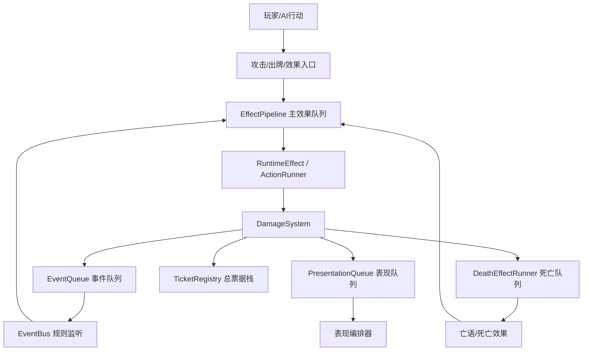
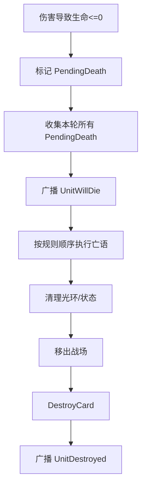

## 效果管线评估报告

> [!NOTE] 2026-06-24 只读复核标注
> 本次只审查当前 Unity 项目实现，不修改代码。对照 `E:\MyUnityProjects\ThirdBattleLine` 当前代码后，原报告中的一部分建议已经落地，下面先给出状态总览；原正文保留，文末追加“待改进部分”。
>
> **已改进**
> - `EffectPipeline` 已支持 `EffectStep` 结构化入队、`CurrentStep` 诊断上下文，`ProcessQueue()` 中 `ProfilerMarker.Begin/End` 已用 `try/finally` 配对，`EventQueue` 获取也已改为 `ServiceLocator.TryGet`。
> - `EventQueue.ProcessAllQueuedEventsImmediate()` 已加入 `MaxImmediateDrainEvents = 4096` 安全上限，命中时会输出最近事件、优先级和队列状态。
> - `EffectBarrier.ResolveAll()` 已改用 `ServiceLocator.TryGet`，并在 `maxPass` 未收敛时输出 pipeline/event/death/context 状态日志。
> - `MicroStepQueue` 已从单纯 `IEnumerator` 升级为 `EffectStep`，包含 `StepId`、`ParentStepId`、来源卡、来源效果、触发事件、调试名、创建帧；重入 drain 和 safety limit 命中也会输出诊断日志。
> - `EventBus` 已从委托累加改为 `EventHandlerEntry` 列表，支持 handler priority、owner card、注册序号和 debug name，并按 priority、owner runtime id、registered sequence 排序。
> - 死亡系统已引入 `DeathBatch`、`DeathBatchEventPayload`、`UnitWillDie` / `DeathCommitted` / `UnitDestroyed` 阶段事件，并把 `DamageTicket` / `CombatTicket` 与 death batch 关联。
> - `DamageSystem` 已在单次伤害和战斗致死分支派发 `UnitDeathPresentationEvent`，并把 ticket 关联到当前 `EffectStep`，对调试链路有明显改善。
>
> **部分改进但还不能视为完成**
> - 死亡批次已经有雏形，但批次排序目前主要依赖 owner hash、入队序号和 RuntimeId，还不是面向卡牌规则的“主动方/控制者/场上位置”完整顺序策略。
> - 表现解耦已经有 `PresentationQueue`、`PresentationEvent`、`PresentationChoreographer` 方向，但 `DeathEffectRunner.RunDeathPresentations()` 仍会 `WaitForSeconds` 并等待 `IAnimationScheduler.PlayDeathVfxRoutine()`，死亡表现还没有完全移出规则链。
> - Ticket 已补充 `EffectStepId`、`ParentEffectStepId`、`DeathBatchId`、`DeathBatchSequence` 等追踪字段，但 `TicketRegistry.NextId()` 仍使用 `Guid.NewGuid()`，`PruneResolved()` 仍未实现，尚不足以支持确定性 replay。
> - `EventBus` 已有排序结构，但排序规则仍偏工程层：priority + RuntimeId + 注册序号；尚未表达“当前行动玩家优先、同玩家从左到右、入场顺序”等明确卡牌规则。
>
结论先说：当前项目的 `EffectPipeline` 已经不是“简单协程队列”，而是具备了卡牌游戏核心结算系统的雏形：主效果队列、事件队列、微步队列、死亡队列、伤害/战斗票据、表现队列解耦都已经存在。以独立商业卡牌项目标准看，功能已经达到“中高级原型到可上线早期架构”之间；但距离炉石、KARDS 这类成熟 TCG/CCG 的“完全可验证、可回放、可扩展、可调试”的规则引擎仍有明显差距。

我的总体评价：

| 维度       | 当前状态                                   | 评价               |
| -------- | -------------------------------------- | ---------------- |
| 效果串行化    | 有 `EffectPipeline` FIFO 串行队列           | 基础完备             |
| 触发事件处理   | 有 `EventQueue` + 优先级 + immediate drain | 中等完备             |
| 嵌套触发控制   | 有 `MicroStepQueue` 扁平化与安全阈值            | 方向正确             |
| 死亡结算     | 有独立 `DeathEffectRunner`、亡语、清理、销毁       | 功能较完整，但规则边界需强化   |
| 伤害/战斗窗口  | 有 Claim / Commit / Finalize 阶段与 Ticket | 架构亮点             |
| 表现解耦     | 已有 `PresentationQueue` 设计与落地           | 方向很好，但仍有残留同步表现   |
| 可调试性     | 有日志、ProfilerMarker、Ticket              | 仍不足              |
| 可回放/确定性  | 部分具备 Ticket，但事件全局顺序与快照不足               | 不完备              |
| 商业级复杂卡支持 | 支持一般亡语、触发、伤害修正                         | 对炉石/KARDS 复杂链仍不够 |

---

## 一、当前效果管线结构概览

核心链路大致如下：



当前系统不是单线的“打一下扣血”，而是已经尝试拆成多个结算层：

1. **主效果队列**：`EffectPipeline`
2. **微步队列**：`MicroStepQueue`
3. **规则事件队列**：`EventQueue`
4. **死亡队列**：`DeathEffectRunner`
5. **结算屏障**：`EffectBarrier`
6. **票据/追踪系统**：`TicketRegistry`、`DamageTicket`、`CombatTicket`
7. **表现队列**：`PresentationQueue`

这说明项目已经在朝“规则引擎 + 表现解耦”的正确方向演进。

---

## 二、`EffectPipeline` 当前功能评估

文件：[Assets/Scripts/Core/EffectPipeline.cs](Assets/Scripts/Core/EffectPipeline.cs)

### 已具备能力

`EffectPipeline` 的核心能力是 FIFO 串行执行效果协程：

```1:40:Assets/Scripts/Core/EffectPipeline.cs
// EffectPipeline.cs
using System.Collections;
using System.Collections.Generic;
using UnityEngine;
using Unity.Profiling; // [2026-04-24] P5 性能治理：引入 ProfilerMarker

public interface IEffectPipeline
{
    void EnqueueEffect(IEnumerator effectRoutine); // 添加效果到队列
    bool IsBusy { get; }
    bool HasQueuedEffects { get; }

    /// <summary>
    /// 等待队列为空（所有效果执行完）
    /// </summary>
    IEnumerator WaitUntilIdle();

    /// <summary>
    /// 在当前裁决窗口内同步 drain 已入队效果，避免等待整个 pipeline 空闲。
    /// </summary>
    [System.Obsolete("Use DrainMicroSteps() instead. This nested recursion approach will be removed in a future version.")]
    IEnumerator DrainQueuedEffectsNested();

    /// <summary>
    /// 使用 MicroStepQueue 扁平执行所有已入队效果，替代嵌套递归的 DrainQueuedEffectsNested。
    /// </summary>
    IEnumerator DrainMicroSteps();
}
```

几个优点很明显：

1. **FIFO 保序**
   - 先入队的效果先执行。
   - 能避免多个效果同时改状态导致状态竞争。

2. **每个效果后刷新事件队列**
   - `ProcessQueue()` 在每个 effect 结束后调用 `EventQueue.ProcessAllQueuedEventsImmediate()`。
   - 这相当于建立了“效果步进窗口”。

```82:105:Assets/Scripts/Core/EffectPipeline.cs
    public IEnumerator ProcessQueue()
    {
        _isRunning = true;
        var _queue = ServiceLocator.Get<EventQueue>();
        try
        {
            while (_effectQueue.Count > 0)
            {
                var effect = _effectQueue.Dequeue();
                // [2026-04-24] P5 性能治理：用 ProfilerMarker Begin/End 包裹每个 effect 的违代执行片段
                // 注意：这里只能用 Begin/End 而非 Auto()，因为协程会在 yield return 处暂停
                s_ProcessQueueMarker.Begin();
                yield return StartCoroutine(effect);
                s_ProcessQueueMarker.End();
    
                // 2026-04-13：这里刻意放在"每个 effect 结束后"而不是整批结束后 flush，目的是让事件驱动的 Buff、触发效果和后续入队逻辑按主流程步进稳定推进。
                if (_queue != null)
                    yield return _queue.ProcessAllQueuedEventsImmediate();
            }
        }
        finally
        {
            _isRunning = false;
        }
    }
```

3. **异常安全有所加强**
   - `_isRunning` 在 `finally` 中复位。
   - 这对 Unity 协程很重要，否则一次异常可能让整条效果管线永久卡死。

4. **已开始与表现层解耦**
   - 注释中明确禁止效果协程等待 DOTween / `WaitForSeconds` / `SpellShowSystem`。
   - 这是非常正确的商业级方向。

5. **支持裁决窗口内 drain**
   - `DrainMicroSteps()` 通过 `MicroStepQueue` 取代旧递归式 drain。
   - 这能降低嵌套触发导致的栈式失控。

### 主要问题

#### 1. `EffectPipeline` 仍然是协程驱动，不是真正的规则命令栈

炉石、KARDS 这类游戏通常不会把核心规则强绑定在 Unity 协程生命周期上，而是接近：

- action stack
- task list
- trigger queue
- death processing step
- state-based action check
- deterministic event log

当前系统的 `IEnumerator` 很方便，但会带来：

- 难以回放。
- 难以序列化。
- 难以在无 Unity 环境下做规则测试。
- 协程中 `yield return` 可能混入表现等待。
- 异常定位困难。

#### 2. 管线缺少统一的“结算帧 / resolution transaction”概念

目前有：

- `EffectPipeline`
- `EventQueue`
- `DeathEffectRunner`
- `EffectBarrier`
- `TicketRegistry`

但它们之间的边界是分散的。比如一次攻击中，规则窗口主要由 `DamageSystem.CombatRoutine()` 手动控制，而不是统一的 `ResolutionContext` 或 `ResolutionTransaction` 驱动。

当前已经有 `ResolutionContext.InDeathEffectChain`、`ResolutionContext.InSpellImpact` 这样的上下文标记，但还不是完整事务模型。

#### 3. `ProfilerMarker.End()` 在 effect 异常时可能不配对

`ProcessQueue()` 中：

```csharp
s_ProcessQueueMarker.Begin();
yield return StartCoroutine(effect);
s_ProcessQueueMarker.End();
```

如果 `StartCoroutine(effect)` 内部异常，中间的 marker 可能无法 `End()`。外层 `finally` 只重置 `_isRunning`，没有保证 profiler marker 成对。这不是规则功能问题，但属于工程健壮性问题。

#### 4. `ServiceLocator.Get<EventQueue>()` 缺失时可能抛异常

`ProcessQueue()` 里直接：

```csharp
var _queue = ServiceLocator.Get<EventQueue>();
```

如果装配失败，整个 pipeline 会失败。其他地方有些用 `TryGet`，这里更适合统一为 `TryGet` 或容错。

---

## 三、`EventQueue` / `EventBus` 评估

文件：[Assets/Scripts/GamePlay/Card/EventQueue.cs](Assets/Scripts/GamePlay/Card/EventQueue.cs)

### 已具备能力

`EventQueue` 已经有：

- 高/中/低优先级。
- 事件批处理。
- `ProcessAllQueuedEventsImmediate()` drain 到稳定状态。
- 若 `EffectPipeline` 忙碌，则帧末 flush 让位于管线显式 flush。

```6:17:Assets/Scripts/GamePlay/Card/EventQueue.cs
/// <summary>
/// 负责把运行时事件按优先级排队，并在合适的 flush 窗口统一分发给 <see cref="EventBus"/>。
/// 它是规则响应层，不负责主流程推进；当 <see cref="IEffectPipeline"/> 正在执行时，事件必须让位给 pipeline 的显式 flush 点，避免打乱效果顺序。
/// </summary>
public class EventQueue : MonoBehaviour
{
    private readonly SortedDictionary<EventPriority, Queue<GameEventData>> _queues
        = new SortedDictionary<EventPriority, Queue<GameEventData>>(new DescendingPriorityComparer());
```

`ProcessAllQueuedEventsImmediate()` 的设计比较关键：

```78:104:Assets/Scripts/GamePlay/Card/EventQueue.cs
    public IEnumerator ProcessAllQueuedEventsImmediate()
    {
        if (_isProcessing) yield break;
        _isProcessing = true;

        /* 
         * [修改日期] 2026-04-13
         * [修改原因] 最近一个月效果系统开始频繁在 handler 中再次 Enqueue 事件，如果只 drain 一轮，后续效果会读到半稳定状态。
         * [修改说明] 这里必须循环处理到“真的没有新事件”为止，确保调用方拿到的是当前裁决窗口内的稳定结果。
         * [影响范围] EffectPipeline flush、法术 impact 结算、Buff/触发效果联动
         */
        while (true)
        {
            int n = DrainOnce(int.MaxValue);
            if (n == 0) break;
        }

        _isProcessing = false;
        yield break; // 保持 IEnumerator 但不中断帧
    }
```

这个“处理到稳定”的思路是对的，类似炉石里的一个触发波次不断清空，直到没有新触发。

### 主要问题

#### 1. 事件优先级太粗

当前只有：

```csharp
public enum EventPriority { High, Normal, Low }
```

这对简单游戏够用，但对复杂卡牌规则不够。例如成熟卡牌系统一般需要区分：

- Before / Replacement / Prevention
- Triggered
- After
- Deathrattle / Last Breath
- Aura refresh
- Cleanup
- UI-only event

炉石中类似“死亡检查、亡语、召唤、奥秘、光环刷新”的顺序非常细。KARDS 也会围绕前线、部署、攻击、撤退、指令牌等有细化窗口。

你当前的 `High/Normal/Low` 只能表达粗略先后，很难长期承载复杂设计。

#### 2. `EventBus` 没有订阅顺序策略

`EventBus` 是简单委托累加：

```157:176:Assets/Scripts/GamePlay/Card/EventQueue.cs
public class EventBus
{
    public static EventBus Instance { get; } = new EventBus();

    private readonly Dictionary<GameEventType, System.Action<GameEventData>> _handlers
        = new Dictionary<GameEventType, System.Action<GameEventData>>();

    public void Register(GameEventType type, System.Action<GameEventData> handler)
    {
        if (!_handlers.ContainsKey(type))
            _handlers[type] = null;

        _handlers[type] += handler;

    }
```

这意味着同一个事件的多个监听者顺序依赖注册顺序。Unity 场景加载、对象创建顺序一变，就可能造成卡牌触发顺序变化。

成熟卡牌游戏一般会有明确规则，例如：

- 当前玩家优先。
- 入场时间排序。
- 从左到右。
- 主动方触发先于被动方。
- 或者按卡牌 `RuntimeSequence` 排序。

当前项目缺少这个层级。

#### 3. 缺少事件安全上限

`EffectPipeline.DrainMicroSteps()` 有 `SafetyLimit`，但 `EventQueue.ProcessAllQueuedEventsImmediate()` 自身没有最大事件数保护。如果事件 handler 无限 enqueue 事件，可能卡死在同一帧。

建议给 `EventQueue` 增加类似：

- `MaxEventsPerImmediateDrain`
- 当前 drain id
- 触发链日志
- 命中上限后输出最近 N 个事件

#### 4. `EventBus` 和 `EventSystem` 双事件系统并存

`EventBus.Invoke()` 里又转发到 `GameManager.Instance.EventSystem`：

```189:197:Assets/Scripts/GamePlay/Card/EventQueue.cs
    public void Invoke(GameEventData data)
    {
        if (_handlers.TryGetValue(data.eventType, out var h) && h != null)
            h.Invoke(data);

        // 桥接：将事件同步转发到 EventSystem，供音效/UI 等订阅者消费
        if (GameManager.Instance?.EventSystem != null)
            GameManager.Instance.EventSystem.Trigger(data.eventType, data);
    }
```

短期可接受，但长期会模糊：

- 哪些是规则事件？
- 哪些是 UI / 音频事件？
- UI 事件是否能反向影响规则？
- 清理顺序如何保证？

建议长期拆成：

- `RuleEventBus`
- `PresentationEventBus`
- `TelemetryEventBus`

---

## 四、`MicroStepQueue` 评估

文件：[Assets/Scripts/Core/MicroStepQueue.cs](Assets/Scripts/Core/MicroStepQueue.cs)

`MicroStepQueue` 是当前系统里非常关键的改进点：

```5:12:Assets/Scripts/Core/MicroStepQueue.cs
/// <summary>
/// 微步队列：将效果执行从嵌套递归改为扁平队列。
/// 参考卡牌游戏的结算机制（如万智牌/炉石传说）。
/// </summary>
public class MicroStepQueue
{
    private readonly Queue<IEnumerator> _steps = new Queue<IEnumerator>();
```

优点：

- 避免旧式 `DrainQueuedEffectsNested()` 递归触发。
- 新增效果追加到队尾。
- 有 `SafetyLimit = 2048`。
- 每个 step 完成后允许外部 flush 事件。

这很接近卡牌游戏里的“任务队列 / action queue”。

问题：

1. **没有 step metadata**
   - 不知道这个 step 来自哪张卡。
   - 不知道 trigger id。
   - 不知道 parent action。
   - 不知道创建时机。
   - 出 bug 很难定位。

2. **只保存 `IEnumerator`**
   - 对调试、回放、AI 推演不友好。
   - 建议后续变成 `EffectStep` 对象：

```csharp
public sealed class EffectStep
{
    public string StepId;
    public string ParentStepId;
    public RuntimeCard Source;
    public EffectSO SourceEffect;
    public GameEventType? TriggeredBy;
    public IEnumerator Routine;
    public int CreatedAtFrame;
}
```

3. **`_isDraining` 重入直接 `yield break`**
   - 如果 drain 中又有人调用 `DrainAll()`，当前实现会直接忽略。
   - 这通常能避免死循环，但也可能隐藏调用方错误。
   - 建议至少记录 warning，附带当前 step 信息。

---

## 五、死亡效果管线评估

文件：[Assets/Scripts/GamePlay/Card/DeathEffectRunner.cs](Assets/Scripts/GamePlay/Card/DeathEffectRunner.cs)

### 已具备能力

`DeathEffectRunner` 已经承担了完整的死亡链：

1. 入死亡队列。
2. flush 事件。
3. 执行亡语。
4. 播放或延迟死亡表现。
5. 清理光环 / 持续效果。
6. 从场上移除。
7. 回填 `DamageTicket`。
8. 发 `UnitKilledInCombat` 和 `CardDestroyed`。
9. `DestroyCard()`。
10. 处理法术 impact 中死亡表现的 fallback。

这是比较完整的死亡系统。

```4:10:Assets/Scripts/GamePlay/Card/DeathEffectRunner.cs
/// <summary>
/// DeathEffectRunner（商业级）
/// 串行处理死亡 → 亡语 → 清理 → 销毁
/// NOTE：不会直接 DestroyCard()，只在亡语执行完后再销毁，信息不会丢失。
/// </summary>
public class DeathEffectRunner : MonoBehaviour
```

特别好的点是：亡语执行时没有等待整个 pipeline idle，而是 drain 当前已入队效果：

```206:215:Assets/Scripts/GamePlay/Card/DeathEffectRunner.cs
                // 将效果加入 EffectPipeline
                pipeline.EnqueueEffect(runtime.BuildRoutine(ctx));

                // 关键：不要等整个 pipeline idle（会和 DamageRoutine 的 Barrier 互锁）
                // 而是把“当前已经入队的效果”在本裁决窗口内跑完
                yield return EffectPipelineUtility.DrainNested(pipeline);
```

这说明你已经遇到并修过死亡链与主效果链互锁的问题。

### 主要问题

#### 1. 死亡事件广播时机不够清晰

`ProcessDeathQueue()` 的 Step 1 注释是“广播死亡事件”，但实际代码只 flush 事件，没有显式 raise 一个统一的 `BeforeDeath` 或 `DeathStarted`：

```43:49:Assets/Scripts/GamePlay/Card/DeathEffectRunner.cs
            // Step 1 —— 广播死亡事件（让光环/被动监听）
           
            if (eventQueue != null) yield return eventQueue.ProcessAllQueuedEventsImmediate();
```

真正的死亡事件 `CardDestroyed` 是后面 `DamageTicket` 存在且 killer 有效时才发：

```133:137:Assets/Scripts/GamePlay/Card/DeathEffectRunner.cs
                    GameEvents.RaiseFromCard(GameEventData.FromUnitKilled(killer, dead, dt), EventPriority.High);
                    GameEvents.RaiseFromCard(GameEventData.FromDeadCard(dead, dead.owner),
               EventPriority.High);
```

这会造成几个问题：

- 非伤害死亡是否能稳定发 `CardDestroyed`？
- 没有 `DamageTicket` 的销毁是否被事件监听感知？
- 无 killer 或 killer 已销毁时是否漏发 `CardDestroyed`？
- “即将死亡”“死亡中”“已销毁”三个阶段没有明确事件。

建议拆成明确阶段：

1. `UnitWillDie`
2. `UnitDeathrattleStarted`
3. `UnitDeathrattleResolved`
4. `UnitRemovedFromBoard`
5. `UnitDestroyed`
6. `UnitKilledBySource`，仅有归因时发

#### 2. 同时死亡处理偏串行

当前死亡队列是 FIFO，一个一个处理：

```36:40:Assets/Scripts/GamePlay/Card/DeathEffectRunner.cs
    /// <summary>
    /// 主循环：依次处理所有死亡单位
    /// </summary>
    private IEnumerator ProcessDeathQueue()
```

这对大部分游戏够用，但炉石类游戏经常有“同时死亡”的概念：

- 两个随从互撞同归于尽。
- AOE 同时击杀多个单位。
- 多个亡语按一定顺序触发。
- 死亡检查后先收集同一批死亡，再按顺序处理亡语。

你当前在 `CombatRoutine` 中对双方是同一阶段扣血后都 `Die()`，这部分还可以。但进入 `DeathEffectRunner` 后仍是逐个亡语+清理。若之后设计需要“本次 AOE 死亡全部视为同时死亡”，当前系统可能出现规则差异。

#### 3. 死亡处理仍含表现等待

`DeathEffectRunner` 中仍有 `WaitForSeconds` 和 `IAnimationScheduler.PlayDeathVfxRoutine()`：

```68:75:Assets/Scripts/GamePlay/Card/DeathEffectRunner.cs
            float combatDeathGap = SpellChoreographySettings.GetActive().combatLethalDeathVfxDelay;
            if (combatDeathGap > 0f &&
                TicketRegistry.Instance.TryGet<DamageTicket>(dead.LastDamageTicketId, out var lastHit) &&
                lastHit.Kind == DamageKind.Combat &&
                lastHit.LethalAtImpact)
                yield return new WaitForSeconds(combatDeathGap);
```

```100:102:Assets/Scripts/GamePlay/Card/DeathEffectRunner.cs
                if (ServiceLocator.TryGet<IAnimationScheduler>(out var anim) && anim != null)
                    yield return anim.PlayDeathVfxRoutine(dead);
```

这与 `EffectPipeline` 注释中的长期目标有冲突。设计文档中也承认死亡 VFX 暂时保留。短期可以接受，但它是当前管线“商业级稳定性”的主要隐患之一。

#### 4. `BackfillLastDamageTicket()` 是死代码且有潜在空引用

文件末尾有未使用的 `BackfillLastDamageTicket()`，而且逻辑中：

```csharp
if (TicketRegistry.Instance.TryGet(dead.LastDamageTicketId, out DamageTicket t) && t != null)
{
   ...
}
t.State = DamageResolutionState.Finalized;
```

如果 `TryGet` 失败，`t.State` 会空引用。虽然当前看似未调用，但建议删除或修复，否则后续维护者可能误用。

---

## 六、`EffectBarrier` 评估

文件：[Assets/Scripts/GamePlay/Effect Barrier/EffectBarrier.cs](Assets/Scripts/GamePlay/Effect Barrier/EffectBarrier.cs)

`EffectBarrier.ResolveAll()` 是当前规则收敛器：

```6:18:Assets/Scripts/GamePlay/Effect Barrier/EffectBarrier.cs
public static class EffectBarrier
{
    public static IEnumerator ResolveAll(int maxPass = 32)
    {
        var eq = ServiceLocator.Get<EventQueue>();
        var pipeline = ServiceLocator.Get<IEffectPipeline>();
        var death = DeathEffectRunner.Instance;
        var ep = pipeline as EffectPipeline;

        for (int pass = 0; pass < maxPass; pass++)
        {
            bool didWork = false;
```

它的目标很清楚：

1. 清空微步队列。
2. final flush 事件。
3. 处理死亡队列。
4. 循环直到没有工作。

这是对的，类似卡牌游戏里“规则系统推进到稳定状态”。

优点：

- 有 `maxPass = 32` 防止无限收敛。
- 死亡链中避免等待死亡 idle，防止死锁。
- `DrainMicroSteps()` 内部每步后 flush 事件，减少外部三段式复杂度。

问题：

1. **命中 `maxPass` 后没有错误日志**
   - 如果 32 轮仍未收敛，会静默退出。
   - 这对规则系统很危险。
   - 建议输出当前 pipeline/event/death 状态。

2. **`ServiceLocator.Get` 无容错**
   - 装配缺失会直接异常。

3. **缺少“本次 barrier 处理了什么”的调试信息**
   - 如果某个 card 造成无限触发，很难回溯。

---

## 七、伤害与战斗票据系统评估

文件：

- [Assets/Scripts/Utilities/DamageSystem.cs](Assets/Scripts/Utilities/DamageSystem.cs)
- [Assets/Scripts/GamePlay/Tickets/DamageTicket.cs](Assets/Scripts/GamePlay/Tickets/DamageTicket.cs)
- [Assets/Scripts/GamePlay/Tickets/CombatTicket.cs](Assets/Scripts/GamePlay/Tickets/CombatTicket.cs)
- [Assets/Scripts/GamePlay/Tickets/TicketRegistry.cs](Assets/Scripts/GamePlay/Tickets/TicketRegistry.cs)

这是当前系统的亮点之一。

### 已具备能力

`DamageSystem` 已经把伤害拆成：

1. `DamageClaim`
2. `EffectBarrier.ResolveAll()`
3. `Commit`
4. `DamageCommitted`
5. `EffectBarrier.ResolveAll()`
6. 死亡等待
7. Finalize
8. 回填票据

```31:64:Assets/Scripts/Utilities/DamageSystem.cs
    private IEnumerator DamageRoutine(DamageRequest req, DamageTicket ticket)
    {
        if (req.Target == null || req.Target.isDestroyed) yield break;
        if (req.Amount <= 0) yield break;

        // 1) DamageClaim
        GameEvents.RaiseFromCard(GameEventData.FromDamageClaim(req.Source, req.Target, ticket.PendingAmount, ticket), EventPriority.High);
        yield return EffectBarrier.ResolveAll();

        ticket.State = DamageResolutionState.Claimed;

        // 2) Commit（应用 PendingAmount）
        int amount = Mathf.Max(0, ticket.PendingAmount);
```

这已经接近成熟卡牌系统的“prevention / modification / commit / after damage”窗口。

战斗也有独立 `CombatTicket`，并为双方各自创建 `DamageTicket`：

```188:202:Assets/Scripts/Utilities/DamageSystem.cs
        // 4) 创建两张 DamageTicket（并关联到 CombatTicket）
        DamageTicket tAD = null;
        DamageTicket tDA = null;

        if (damageToDef > 0)
        {
            tAD = TicketRegistry.Instance.CreateDamageTicket(new DamageRequest(attacker, defender, damageToDef, DamageKind.Combat));
            tAD.AttachCombat(ct, CombatDamageRole.AttackerToDefender);
            ct.AttackDamageTicketId = tAD.Id;
        }
```

这是很好的设计，后续支持：

- 减伤。
- 反伤。
- “若本次攻击消灭目标”。
- 对战记录。
- AI 评估。
- Replay log。

### 主要问题

#### 1. `TicketRegistry.NextId()` 有 Guid 生成不一致问题

当前：

```25:26:Assets/Scripts/GamePlay/Tickets/TicketRegistry.cs
    private string NextId(string prefix)
        => $"{prefix}_{++_seq}_{Guid.NewGuid():N}".Substring(0, Math.Min(32, $"{prefix}_{_seq}_{Guid.NewGuid():N}".Length));
```

这里调用了两次 `Guid.NewGuid()`，一次用于实际字符串，一次用于长度计算。虽然长度基本固定，不一定导致功能 bug，但代码不严谨，也不利于可复现。

更重要的是：Guid 随机 ID 不利于 replay deterministic。商业级卡牌规则引擎最好使用对局内递增序号。

#### 2. `TicketRegistry.PruneResolved()` 未实现

```44:49:Assets/Scripts/GamePlay/Tickets/TicketRegistry.cs
    /// <summary>
    /// 对局长了以后清票据，避免字典无限涨
    /// </summary>
    public void PruneResolved(int keepLastN = 2000)
    {
        // 这里给简单策略：后面要做回放/对局日志，
```

长局、PVE、无尽模式会积累大量 ticket。现在有风险。

#### 3. `CombatTicket` 回填不完整

`CombatTicket` 有：

```csharp
public bool AttackerDeathResolved;
public bool DefenderDeathResolved;
public bool DefenderKilledByAttacker;
```

但 `DamageSystem.CombatRoutine()` 只回填了部分字段：

```383:385:Assets/Scripts/Utilities/DamageSystem.cs
        ct.AttackerSurvived = !attacker.isDestroyed;
        ct.DefenderDestroyedFinally = defender.isDestroyed;
```

没有看到 `AttackerDeathResolved`、`DefenderDeathResolved`、`DefenderKilledByAttacker` 的完整回填。这会影响后续“本次攻击是否击杀”等条件。

#### 4. `DamageTicket` 持有 RuntimeCard 引用

```51:52:Assets/Scripts/GamePlay/Tickets/DamageTicket.cs
    internal RuntimeCard SourceRef { get; }
    internal RuntimeCard TargetRef { get; }
```

这对当前运行时方便，但对对象池、回放、跨帧表现、AI 沙盒都存在风险。建议长期让 Ticket 主要存：

- RuntimeId
- CardInstanceId
- owner id
- zone snapshot
- display name snapshot
- source/target weak lookup

引用可以作为运行时优化，但不能作为唯一真相。

---

## 八、表现解耦评估

文件：

- [Assets/Scripts/Core/Presentation/PresentationQueue.cs](Assets/Scripts/Core/Presentation/PresentationQueue.cs)
- [Docs/Design/effect-pipeline-presentation-queue-decoupling.md](Docs/Design/effect-pipeline-presentation-queue-decoupling.md)

这是非常正确的架构方向。

设计文档中明确写到：

- `EffectPipeline` 只跑规则。
- `IPresentationQueue` 只收表现事件。
- `PresentationChoreographer` 在 Update 消费。
- 逻辑层不等待动画。

这和炉石/KARDS 是同方向的：规则先结算，表现按事件日志播放。

不过当前项目处在过渡期：

- 法术表现已部分解耦。
- 死亡表现仍部分耦合。
- 伤害反馈可能仍有历史 capture 逻辑。
- `DeathEffectRunner` 中仍有 `WaitForSeconds` 和动画等待。

这不是错误，但要明确：当前尚未完成完全解耦。

---

## 九、对比炉石传说、KARDS

### 1. 与炉石传说对比

炉石的核心特点：

- 行动会拆成大量内部 task。
- 触发有严格队列。
- 死亡检查是独立系统。
- 亡语、奥秘、光环、召唤后触发有固定时序。
- 游戏状态是服务器权威且可回放。
- 表现是根据规则事件播放，不决定规则。

你的系统已经具备类似方向：

| 炉石能力 | 当前项目对应 | 差距 |
|---|---|---|
| Action queue | `EffectPipeline` / `MicroStepQueue` | step 缺少 metadata |
| Trigger queue | `EventQueue` | 触发顺序太粗 |
| Death processing | `DeathEffectRunner` | 同时死亡批次不足 |
| Damage windows | `DamageClaim/Commit/Finalize` | 窗口定义还不系统 |
| Event log | Ticket + BattleRecord | 不完整，不足以 replay |
| Presentation async | `PresentationQueue` | 仍有死亡表现耦合 |
| Determinism | 部分 | Guid、协程、注册顺序影响确定性 |

整体看：你已经实现了炉石规则引擎的“重要骨架”，但还缺“严格顺序规则、全量事件日志、稳定 replay”。

### 2. 与 KARDS 对比

KARDS 的规则复杂性与炉石不同：

- 有前线机制。
- 有部署线。
- 单位类型、指令、反制、部署效果、攻击限制都较强。
- 更像桌面战争卡牌，位置和战线对规则影响大。

你的项目目前从代码看更偏：

- 单位上场。
- 攻击目标。
- 伤害/亡语/效果。
- 目标筛选。
- 持续效果/光环。

如果未来要接近 KARDS，重点差距不只在效果管线，还在：

1. **区域和位置事件不够结构化**
   - `ZoneSystem`、`FieldState` 可能有，但事件管线里没有明确 `ZoneChanged` / `PositionChanged` / `FrontlineChanged` 类型窗口。

2. **行动合法性和结算管线分离不足**
   - 当前 `TargetResolver`、`AttackPipeline`、`DamageSystem` 各自校验。
   - KARDS 类游戏更需要统一 action validator。

3. **回合内历史追踪需要更强**
   - KARDS 类卡牌常需要“本回合部署过几次”“哪条线移动过”“本单位是否从预备区进前线”等历史条件。
   - 当前 Ticket 能做一部分，但不是完整 turn event log。

---

## 十、功能完备性判断

### 已经比较完备的部分

1. 单效果串行执行。
2. 效果后触发事件。
3. 事件反向入队效果。
4. 亡语触发。
5. 死亡后清理。
6. 伤害前后窗口。
7. 战斗双方同时扣血的基础支持。
8. 伤害归因。
9. 对战记录基础。
10. 表现队列解耦方向。

### 尚不完备的部分

1. 触发顺序没有商业级确定性。
2. 同时死亡批处理不够明确。
3. 事件阶段不够细。
4. Ticket 不能完整 replay。
5. 管线仍依赖 Unity 协程，不利于纯逻辑测试。
6. 事件队列缺无限循环保护。
7. 死亡管线仍混入表现等待。
8. 规则事件和 UI 事件边界仍模糊。
9. 缺少统一“结算事务”对象。
10. 缺少完整调试工具链。

---

## 十一、优先改进建议

### P0：先修潜在稳定性问题

这些建议优先级最高，但改动不大。

#### 1. 给 `EventQueue.ProcessAllQueuedEventsImmediate()` 加安全上限

原因：避免 handler 无限 enqueue 事件导致整帧卡死。

建议：

- 增加 `MaxImmediateEvents = 4096`。
- 每处理一个事件计数。
- 超过后报错并停止。
- 日志输出最近事件类型、source、target。

#### 2. `EffectBarrier.ResolveAll()` 命中 `maxPass` 时输出错误

当前静默退出太危险。建议输出：

- pass 数。
- pipeline 是否有 queue。
- eventQueue 是否有 event。
- deathQueue 数量。
- 当前 `ResolutionContext`。

#### 3. 修复或删除 `DeathEffectRunner.BackfillLastDamageTicket()`

虽然目前未调用，但它是潜在炸点。

#### 4. `EffectPipeline` 的 profiler marker 用 `try/finally` 配对

避免异常后 profiler marker 不成对。

---

### P1：强化规则确定性

#### 1. 事件订阅增加排序策略

建议事件 handler 不再只是委托累加，而是保存为：

```csharp
public sealed class EventHandlerEntry
{
    public RuntimeCard Owner;
    public EffectSO SourceEffect;
    public int ControllerSeat;
    public int BoardOrder;
    public long RegisteredSequence;
    public Action<GameEventData> Handler;
}
```

排序规则可先简单定为：

1. 当前行动玩家优先。
2. 同玩家按场上从左到右。
3. 再按注册序号。

这会显著提升规则可预测性。

#### 2. `MicroStepQueue` 引入 `EffectStep`

不要只存 `IEnumerator`。至少加：

- step id
- source card
- source effect
- parent event
- enqueue sequence
- debug name

这样出现无限触发时能定位是哪张卡。

---

### P2：死亡系统升级为“死亡批次”

建议从当前单张 FIFO，升级为：



好处：

- 支持 AOE 同时死亡。
- 支持“所有死亡单位的亡语按顺序触发”。
- 支持“如果本轮有友方单位死亡”等条件更准确。
- 更接近炉石的死亡检查模型。

---

### P3：完成规则与表现解耦

目标：`DeathEffectRunner` 不再 `WaitForSeconds`，也不直接 `PlayDeathVfxRoutine()`。

推荐最终状态：

- `DamageSystem` / `DeathEffectRunner` 只发 `UnitDeathPresentationEvent`。
- `PresentationChoreographer` 播死亡 VFX。
- 规则层立即完成 `DestroyCard()` 或标记 `isDeadPending` + 逻辑移场。
- 视图层自己延迟回收视图。

当前设计文档已经有这个方向，只需要继续推进。

---

### P4：建立完整 `ResolutionTransaction`

当前 `ResolutionContext` 是一些静态上下文标记，建议升级为完整结算事务：

```csharp
public sealed class ResolutionTransaction
{
    public string Id;
    public string RootActionId;
    public RuntimeCard Actor;
    public List<EffectStep> Steps;
    public List<GameEventData> Events;
    public List<IGameTicket> Tickets;
    public int StartedFrame;
    public int EndedFrame;
}
```

所有 `EffectPipeline`、`EventQueue`、`DeathEffectRunner` 都把执行内容挂到 transaction 下。

好处：

- 调试清晰。
- 可视化链路。
- 可做 replay。
- AI 可以复用。
- 出 bug 时能导出一整条结算链。

---

### P5：TicketRegistry 改为确定性、可清理、可回放

建议：

1. `NextId` 改为纯递增。
2. 增加 `ResetForMatch()`。
3. 实现 `PruneResolved()`。
4. Ticket 内保存必要快照，而不仅是引用。
5. 对 `CombatTicket` 补齐回填字段。

---

### P6：拆分规则事件和表现事件

长期建议：

- `RuleEventQueue`：只影响规则。
- `PresentationQueue`：只影响表现。
- `Telemetry/BattleRecord`：只记录，不反向影响规则。

当前 `EventBus.Invoke()` 同时触发 `GameManager.Instance.EventSystem`，短期可以保留，但建议逐步迁移。

---

## 十二、建议的阶段性路线图

### 阶段 1：稳定性修补，低风险

目标：减少死锁、无限触发、静默失败。

修改范围：

- [Assets/Scripts/GamePlay/Card/EventQueue.cs](Assets/Scripts/GamePlay/Card/EventQueue.cs)
- [Assets/Scripts/GamePlay/Effect Barrier/EffectBarrier.cs](Assets/Scripts/GamePlay/Effect Barrier/EffectBarrier.cs)
- [Assets/Scripts/Core/EffectPipeline.cs](Assets/Scripts/Core/EffectPipeline.cs)
- [Assets/Scripts/GamePlay/Card/DeathEffectRunner.cs](Assets/Scripts/GamePlay/Card/DeathEffectRunner.cs)

建议内容：

- EventQueue safety limit。
- EffectBarrier maxPass 日志。
- EffectPipeline profiler marker finally。
- 删除/修复死代码。

### 阶段 2：调试能力增强

目标：能看懂一条复杂连锁为什么发生。

修改范围：

- `MicroStepQueue`
- `EffectPipeline`
- `EventQueue`
- `TicketRegistry`

建议内容：

- 新增 `EffectStep`。
- 事件记录最近 N 条。
- Ticket 增加 debug summary。
- Battle log 可显示触发链。

### 阶段 3：死亡批次重构

目标：支持 AOE、同时死亡、复杂亡语。

修改范围：

- `DeathEffectRunner`
- `DamageSystem`
- 相关测试

建议内容：

- 收集 death batch。
- 明确 `UnitWillDie` / `UnitDestroyed`。
- 亡语顺序规则固定化。
- 与 Ticket 归因对齐。

### 阶段 4：完全表现解耦

目标：规则层不等待动画。

修改范围：

- `DeathEffectRunner`
- `PresentationChoreographer`
- `IAnimationScheduler`
- `CardViewController`

建议内容：

- 死亡 VFX 全部进 `PresentationQueue`。
- 规则先完成，表现异步播放。
- View handle 拍照，避免 RuntimeCard 被池复用后表现错乱。

### 阶段 5：可回放/确定性

目标：接近炉石/KARDS 商业级基础。

建议内容：

- 对局随机种子。
- 纯递增 action id。
- 完整 event log。
- 规则层脱离 Unity 协程的长期改造。
- AI 沙盒与真实结算共用同一规则模型。

---

## 十三、最终评价

当前系统已经具备一个成熟卡牌规则引擎的核心形状，尤其是以下设计值得保留并继续投资：

1. `EffectPipeline` 串行规则队列。
2. `MicroStepQueue` 扁平化触发链。
3. `EventQueue` 稳定 drain。
4. `DamageClaim / Commit / Finalize` 分阶段伤害。
5. `DamageTicket / CombatTicket` 归因系统。
6. `PresentationQueue` 表现解耦方向。
7. `DeathEffectRunner` 独立死亡链。

但如果对标炉石、KARDS，当前还不能算“完全完备”。主要差距不是“能不能实现某个效果”，而是：

- 复杂连锁下是否绝对稳定。
- 多触发顺序是否可解释。
- 同时死亡是否规则严谨。
- 是否能 replay。
- 是否能脱离 Unity 表现层测试。
- 出现无限触发时是否能快速定位。
- 规则层是否完全不被动画影响。

我建议优先不要大改架构，而是按“稳定性 → 可调试 → 死亡批次 → 表现解耦 → 可回放”的顺序演进。这样风险最低，也最符合当前项目已有代码的演进方向。
---

## 十四、2026-06-24 复核后的待改进部分

> 下面是基于当前代码状态重新整理的待办。已落地的 P0/P1 稳定性与诊断项不再重复列为待办，只保留仍有工程或规则风险的部分。

### 1. Ticket 确定性与清理仍需完成

当前 `TicketRegistry.NextId()` 仍使用 `Guid.NewGuid()`，并且 `PruneResolved()` 仍为空实现。后续如果要做 replay、AI 沙盒、长局 PVE 或问题回放，建议优先改为对局内纯递增 ID，并补齐 `ResetForMatch()`、`PruneResolved()` 和必要快照字段。

### 2. 死亡表现还没有完全从规则链移出

`DamageSystem` 已经派发 `UnitDeathPresentationEvent`，但 `DeathEffectRunner.RunDeathPresentations()` 仍包含 `WaitForSeconds` 和 `IAnimationScheduler.PlayDeathVfxRoutine()`。这意味着死亡结算仍可能被动画时长影响。建议把死亡 VFX 全部迁移到 `PresentationQueue` / `PresentationChoreographer`，规则层只负责死亡批次、亡语、清理和销毁。

### 3. 死亡批次顺序需要规则化

`DeathBatch` 已经存在，但排序规则还不是完整卡牌规则。建议明确采用一套可解释顺序，例如：当前行动玩家优先、控制者顺序、场上从左到右、入场序号或 RuntimeSequence。避免使用 `RuntimeHelpers.GetHashCode(owner)` 这类非规则语义排序作为长期依据。

### 4. 事件 handler 顺序还需从工程排序升级为规则排序

`EventBus` 已有 `EventHandlerEntry`，这是重要进展。但当前排序主要是 priority、owner RuntimeId、注册序号。后续建议把 owner seat、board order、entered sequence、source effect priority 纳入 handler metadata，让触发顺序符合卡牌规则而不是对象创建细节。

### 5. 事件阶段仍偏粗

`EventPriority` 仍只有 `High / Normal / Low`。对于复杂卡牌，仍建议拆出更明确的窗口：Before/Replacement/Prevention、DamageClaim、DamageCommitted、AfterDamage、DeathCheck、Deathrattle、AuraRefresh、Cleanup、PresentationOnly 等。可以渐进添加，不必一次性大重构。

### 6. 规则事件与表现/UI事件仍需继续拆分

`EventBus.Invoke()` 仍会同步桥接到 `GameManager.Instance.EventSystem`。短期可保留，但长期建议明确 `RuleEventQueue`、`PresentationQueue`、`Telemetry/BattleRecord` 的边界，防止 UI/音频订阅反向影响规则时序。

### 7. `ResolutionTransaction` 仍未建立

当前已经有 `EffectStep`、Ticket、DeathBatch，调试链路明显增强，但它们还没有统一挂到一个完整的 `ResolutionTransaction` 下。后续可把一次攻击、一次出牌或一次触发链收束成事务对象，记录 steps、events、tickets、death batches、开始/结束帧，便于可视化、导出和 replay。

### 8. Ticket 快照仍不够完整

`DamageTicket` 仍保留 `SourceRef` / `TargetRef` 运行时引用。虽然已有 RuntimeId 字段，但长期建议补齐显示名、owner、zone、board index、card instance id 等不可变快照，避免对象池复用、跨帧表现或回放时引用失效。

### 9. CombatTicket 最终击杀归因仍需补齐

`DeathEffectRunner` 已能把 death batch 写回 `CombatTicket.AttackerDeathResolved` / `DefenderDeathResolved`，`DamageTicket.KilledByThisSource` 也有回填。但 `CombatTicket.DefenderKilledByAttacker` 等最终归因字段仍未看到稳定写回路径。建议把战斗最终归因集中在一个 finalize 方法中统一计算。

### 10. 纯逻辑测试与回放能力仍是长期目标

当前核心仍是 Unity 协程驱动，短期可接受。若后续要接近炉石/KARDS 级别的可验证规则引擎，需要逐步让规则命令、事件日志、随机种子、action id 和状态快照可以在无 Unity 表现层环境中运行和复现。

