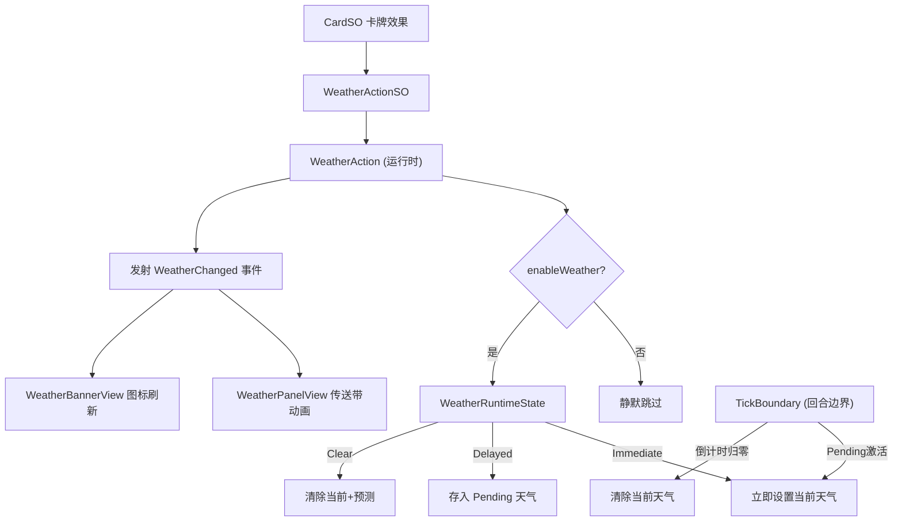

# 天气系统

## 1. 通用天气规则

1. 当前版本只保留三种天气：平常天、艳阳天、雨天。

2. 天气是全场状态，同一时间只能存在一种当前天气。

3. 天气牌文本写作：
   “预测天气为雨天（1）。”
   “预测天气为艳阳天（2）。”

4. 括号中的数字表示该天气成为当前天气后持续的完整轮次数。
   1 个完整轮次 = 双方玩家各完成 1 个自己的回合。

5. 对局开始时，当前天气为平常天，预测天气为空。

6. 若当前天气为平常天，打出预测天气牌时，该天气立即成为当前天气。

7. 若当前天气不是平常天，且当前天气尚未进入“将散”阶段，打出预测天气牌时，只会设置预测天气，不会改变当前天气。

8. 若当前天气不是平常天，但当前天气已经进入“将散”阶段，打出预测天气牌时，该天气会立即成为当前天气，并清空预测天气。

9. 当前天气剩余 0.5 个完整轮次时，进入“将散”阶段。

10. 当前天气自然结束时：
    - 若存在预测天气，则预测天气成为新的当前天气；
    - 若不存在预测天气，则天气回到平常天。

11. 每名玩家每个自己的回合最多只能执行 1 次天气效果。

12. 清除天气会立即将当前天气改为平常天，并清空预测天气。

13. 强力改变天气可以无视当前天气是否将散，立即改变当前天气。

# 用例子看效果

假设 A 是先手。

## 情况一：A 打雨天（1）

```
A1：预测天气为雨天（1）
```

因为当前是平常天，所以立即生效：

```
当前天气 = 雨天剩余 = 1 个完整轮次
```

A 回合结束后：

```
当前天气 = 雨天剩余 = 0.5 个完整轮次状态 = 雨云将散
```

此时轮到 B。

B 现在可以打：

```
预测天气为艳阳天（1）
```

因为当前天气已经将散，所以它不再只是预测，而是直接生效：

```
当前天气 = 艳阳天剩余 = 1 个完整轮次预测天气 = 空
```

这就给了后手一个明确反制窗口。

---

## 情况二：A 打雨天（2）

```
A1：预测天气为雨天（2）
```

立即生效：

```
当前天气 = 雨天剩余 = 2 个完整轮次
```

A 结束后：

```
雨天剩余 = 1.5
```

B 此时不能直接改天气，只能预测：

```
B1：预测天气为艳阳天（1）预测天气 = 艳阳天（1）当前天气仍然是雨天
```

等雨天剩余到 0.5 时，下一名玩家就会看到：

```
雨云将散
```

这个时候再打天气，就可以直接接管当前天气。

## 3. 艳阳天

设计定位：火元素主场，强化爆发、点燃和部分土火攻势。

| 模块    | 效果              |
| ----- | --------------- |
| 入场校正  | 立即移除所有火元素单位的熄灭。 |
| 火 → 木 | 点燃必定触发。         |
| 水 → 火 | 熄灭禁止触发。         |
| 木 → 土 | 根裂概率-15%。       |
| 火 → 金 | 熔蚀概率+25%。       |
| 土 → 水 | 淤塞概率+25%。       |

## 4. 雨天

设计定位：水元素主场，保护木元素，削弱火元素爆发。

| 模块 | 效果 |
| --- | --- |
| 入场校正 | 立即移除所有木元素单位的点燃。 |
| 水 → 火 | 熄灭必定触发。 |
| 火 → 木 | 点燃禁止触发。 |
| 木 → 水 | 仅雨天可以触发吸收。 |
| 木 → 土 | 根裂概率+20%。 |
| 土 → 水 | 淤塞概率-25%。 |
| 火 → 金 | 熔蚀概率-25%。 |

## 5. 文案句式

| 效果等级 | 推荐句式 |
| --- | --- |
| 普通天气效果 | 预测天气为雨天。 |
| 强力立即天气 | 将天气改变为艳阳天。 |
| 净天效果 | 清除当前天气。 |
| 复合效果 | 清除当前天气和预测天气。 |



