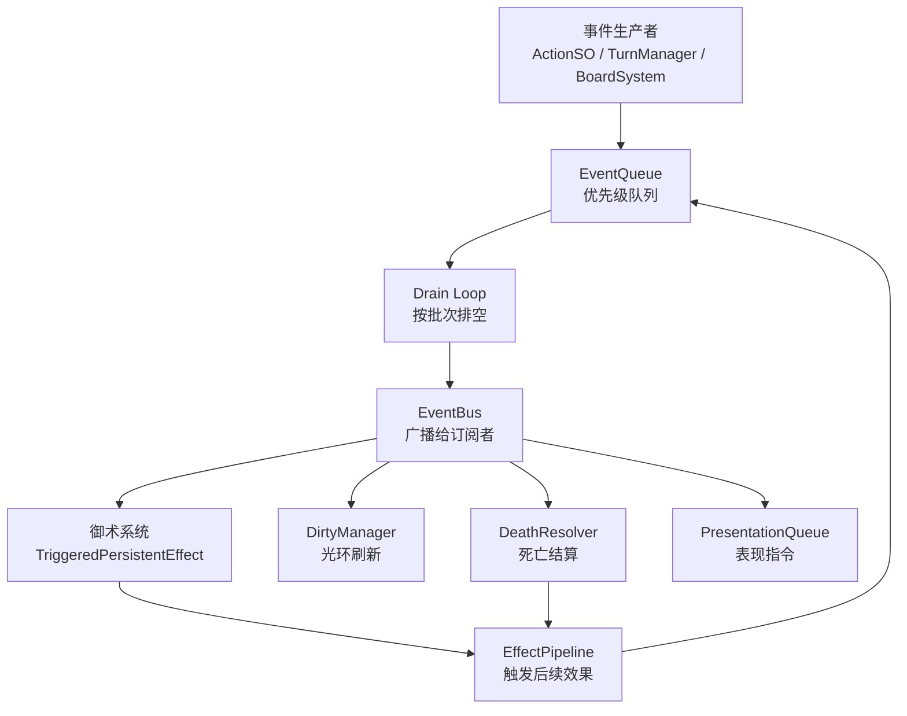
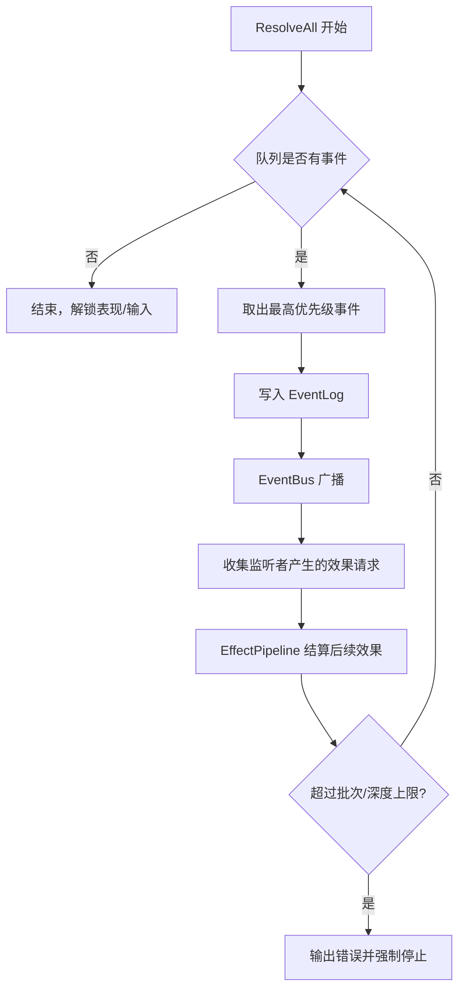
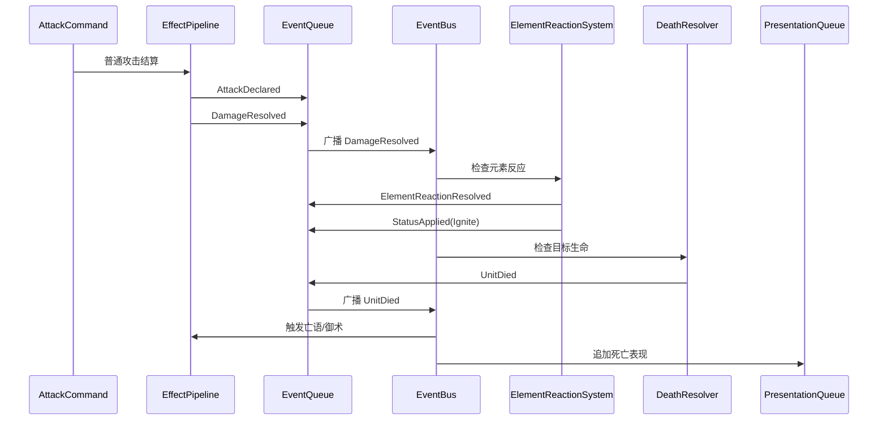

# 事件系统

事件系统用于连接规则变化、持续监听、御术触发、光环刷新和表现播放。它的核心目标不是“所有东西都事件化”，而是让效果连锁有稳定顺序、可调试日志和防递归保护。

## 总体结构



## EventQueue 与 EventBus 分工

| 模块 | 职责 | 说明 |
| --- | --- | --- |
| `EventQueue` | 保存待处理事件，按优先级和入队序排空。 | 保证事件处理顺序稳定，并防止递归爆栈。 |
| `EventBus` | 将当前事件广播给监听者。 | 监听者只产生后续效果或标记 Dirty，不直接改变队列遍历状态。 |
| `EventLog` | 记录已经处理过的事件。 | 用于测试、复盘、网络调试和问题定位。 |

## 事件优先级

| 优先级 | 使用场景 | 示例 |
| --- | --- | --- |
| High | 必须立即保持规则一致性的事件。 | 死亡检查、胜负检查、强制清理非法状态。 |
| Normal | 常规规则事件。 | 打出卡牌、造成伤害、治疗、攻击后、天气改变。 |
| Low | 表现、统计、成就等不影响当前结算的事件。 | 播放提示、任务计数、埋点。 |

同优先级事件按入队序处理。一个事件在广播时产生的新事件，不插入当前广播过程，而是进入后续批次。

## 事件数据结构

| 字段 | 说明 |
| --- | --- |
| `EventId` | 单局内递增 ID。 |
| `Type` | 事件类型枚举。 |
| `Priority` | High / Normal / Low。 |
| `SourceId` | 来源卡牌、单位、玩家或系统。 |
| `OwnerId` | 事件归属玩家，可为空。 |
| `Targets` | 目标实例列表。 |
| `Payload` | 伤害值、元素、天气、区域变化等扩展数据。 |
| `BatchId` | 所属事件批次。 |
| `CausedBy` | 上游事件或指令 ID。 |

## 首版事件类型

| 事件 | 触发时机 | 主要消费者 |
| --- | --- | --- |
| `MatchStarted` | 对局初始化完成。 | 任务、引导、表现。 |
| `TurnStarted` | 行动方进入回合开始。 | 回合开始效果、天气 Tick、抽牌表现。 |
| `ManaRefreshed` | 法力上限增长并回满。 | 表现层、任务。 |
| `CardPlayed` | 玩家从手牌打出卡牌并支付费用。 | 御术、任务、表现。 |
| `UnitDeployed` | 妖怪从手牌派遣到战场。 | 派遣监听、光环 Dirty。 |
| `UnitEnteredBoard` | 单位通过派遣、召唤、征召进入战场。 | 光环 Dirty、入场表现。 |
| `UnitMoved` | 单位从第二阵列移动至第一阵列。 | 阵列光环、表现。 |
| `AttackDeclared` | 攻击合法并支付费用后。 | 御术、攻击前修正。 |
| `DamageResolved` | 伤害写入状态后。 | 死亡检查、根裂、任务、表现。 |
| `HealingResolved` | 治疗写入状态后。 | 表现、任务。 |
| `ElementReactionResolved` | 元素反应判定完成。 | 表现、状态监听。 |
| `StatusApplied` | Buff/Debuff 增加或刷新。 | DirtyManager、表现。 |
| `WeatherChanged` | 当前天气或预测天气变化。 | 元素系统、光环、天气 UI。 |
| `UnitDied` | 单位死亡并进入场外牌堆。 | 亡语、光环 Dirty、表现。 |
| `CardSealed` | 单位进入公共封存卡组。 | 征召相关监听、表现。 |
| `UnitRecruited` | 从封存卡组征召单位。 | 入场监听、表现。 |
| `TurnEnded` | 行动方结束回合。 | 回合结束效果、状态清理。 |
| `GameEnded` | 胜负成立。 | 结算界面、统计、存档。 |

## Drain Loop



### 防递归策略

| 策略 | 说明 |
| --- | --- |
| 批次上限 | 单次玩家指令最多处理固定批次数，例如 128。超过说明存在循环。 |
| 深度上限 | 记录 `CausedBy` 链路深度，例如不超过 32。 |
| 同事件去重 | 同一来源、同一目标、同一事件类型在必要场景下可去重。 |
| 延迟死亡结算 | 一批 Action 完成后统一死亡检查，避免重复入队。 |
| 只读监听匹配 | 监听者匹配事件时不修改队列，只返回触发请求。 |

## 事件处理时序示例：攻击造成点燃并死亡



## 订阅者规范

| 订阅者 | 可以做 | 不应做 |
| --- | --- | --- |
| 御术系统 | 匹配事件并返回触发请求。 | 在遍历监听列表时直接移除或结算。 |
| DirtyManager | 标记受影响的光环范围。 | 立即逐单位重算所有 Modifier。 |
| DeathResolver | 收集死亡单位并生成死亡事件。 | 在伤害 Action 内反复结算死亡。 |
| PresentationBridge | 生成表现指令。 | 根据表现结果修改规则状态。 |
| QuestTracker | 记录任务进度。 | 阻塞规则结算。 |

## 与表现队列的关系

事件系统可以为表现层提供顺序信息，但表现队列必须独立存在。原因是规则事件可能非常细，而表现需要合并和节奏控制。

示例：

| 规则事件 | 表现处理 |
| --- | --- |
| `DamageResolved` | 播放受击、扣血数字、血条变化。 |
| `StatusApplied(Ignite)` | 播放点燃特效并显示状态图标。 |
| `UnitDied` | 等受击表现完成后播放死亡动画。 |
| `WeatherChanged` | 切换背景、天气粒子和元素提示。 |

## 日志示例

```text
[Event] #104 Batch=8 Type=DamageResolved Source=unit_23 Target=unit_41 Payload={damage:3, element:Fire}
[Event] #105 Batch=9 Type=ElementReactionResolved Source=unit_23 Target=unit_41 Payload={reaction:Ignite, success:true, roll:0.32, chance:0.43}
[Event] #106 Batch=9 Type=StatusApplied Source=unit_23 Target=unit_41 Payload={status:Ignite, duration:2}
```

## 测试清单

| 用例 | 验证点 |
| --- | --- |
| 同优先级顺序稳定 | 入队 A、B、C，处理顺序保持 A、B、C。 |
| 高优先级先处理 | Normal 事件已在队列中时，新 High 事件先处理。 |
| 新事件进入下一批次 | 事件回调产生的新事件不打断当前广播。 |
| 御术列表安全修改 | 多个御术同批触发时不跳过、不重复。 |
| 死亡事件不重复 | 同一单位同一批次只产生一次 `UnitDied`。 |
| 循环触发被截断 | 超过批次或深度上限时输出可定位日志。 |

