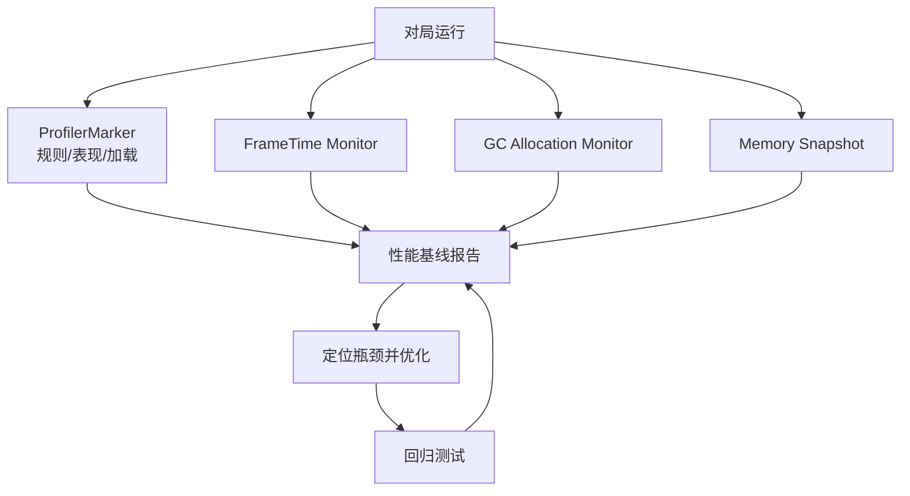
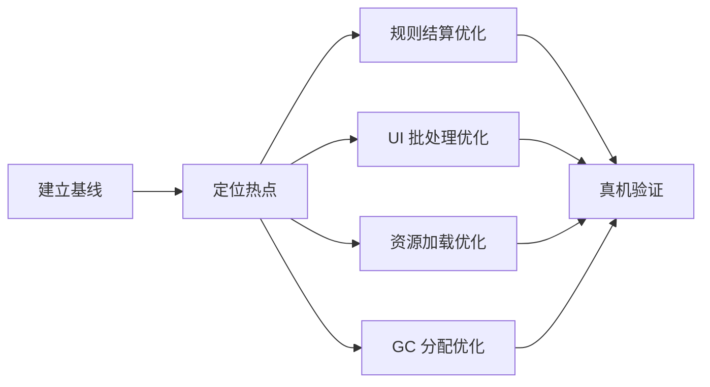
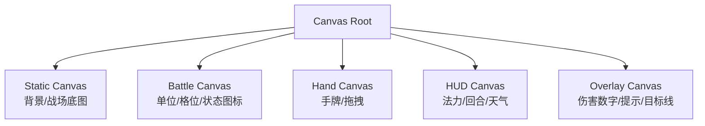
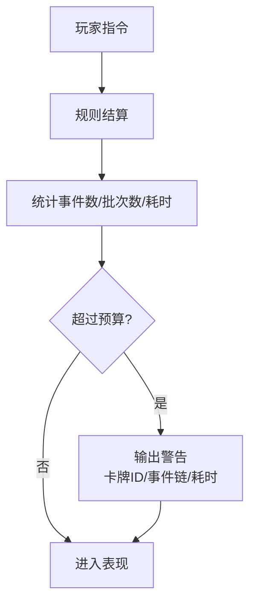

# 性能优化

性能目标以移动端为主：对局内操作需要稳定、跟手、无明显卡顿。优化重点不是过早追求极限帧率，而是建立可量化基线，避免卡牌 UI、事件结算、资源加载和 GC 分配在中后期内容量上来后失控。

## 性能目标

| 指标 | 目标 | 说明 |
| --- | --- | --- |
| 帧率 | 移动端 30 FPS 稳定，目标机型可选 60 FPS。 | 对局内动画和拖拽优先稳定。 |
| 单帧耗时 | 30 FPS 下低于 33.3 ms。 | 规则结算可短暂高于平均，但不能造成明显卡死。 |
| GC 分配 | 主行动阶段接近 0 B/frame。 | 拖拽、Hover、目标高亮不能持续分配。 |
| 对局加载 | 常规卡组 3 秒内进入战场。 | 具体以目标机型实测为准。 |
| 输入延迟 | 拖拽和点击反馈低于 100 ms。 | 规则结算期间可锁输入，但要有视觉反馈。 |

## 性能监控图

## 已有优化方向

| 方向 | 说明 |
| --- | --- |
| 解析式扇形布局 | 手牌布局通过公式计算，减少手牌变化时的复杂 UI 排版。 |
| 卡牌视图对象池 | 对局内卡牌 View、伤害数字、状态图标复用，减少频繁 Instantiate/Destroy。 |
| 音效发射器池 | 高频短音效复用 AudioSource。 |
| DirtyManager | 光环和 UI 状态批量刷新，避免每帧全量扫描。 |
| ProfilerMarker | 给效果管线、事件排空、表现队列、目标解析加性能标记。 |

## 优化优先级

### 优先级判断

| 等级 | 条件 | 处理 |
| --- | --- | --- |
| P0 | 会造成卡死、崩溃、无法对局。 | 立即修复。 |
| P1 | 对局核心操作明显掉帧或拖拽不跟手。 | 当前版本修复。 |
| P2 | 局外页面偶发卡顿或首次加载慢。 | 排期优化。 |
| P3 | 低频编辑器工具或开发期问题。 | 有余量再处理。 |

## UI 性能

卡牌游戏的性能压力很大一部分来自 UGUI：手牌扇形、卡牌悬停、目标高亮、状态图标、伤害数字、拖拽层级变化都会触发 Canvas rebuild。

### UI 分层建议

### 具体策略

| 问题 | 策略 |
| --- | --- |
| 手牌移动导致全 UI rebuild | 手牌单独 Canvas，拖拽时只移动拖拽层。 |
| 频繁 LayoutGroup 计算 | 对局内固定区域用手写布局或缓存坐标。 |
| Hover 每帧刷新文本 | 只有目标变化时刷新详情面板。 |
| 状态图标 Instantiate | 使用图标对象池，状态变化时批量刷新。 |
| 伤害数字频繁创建 | 对象池 + DOTween 复用，播放完成后回收。 |

## 规则结算性能

规则层的目标是“单次指令结算快、可预测、无隐藏分配”。

| 模块 | 风险 | 优化 |
| --- | --- | --- |
| `TargetResolver` | 每次效果全场 LINQ 过滤。 | 使用预分配列表，按区域索引候选目标。 |
| `EventBus` | 广播时 ToList 分配。 | 监听列表使用稳定快照或对象池列表。 |
| `EffectPipeline` | 连锁过深导致长帧。 | 分批处理，必要时在表现阶段切片，但规则结果仍保持顺序。 |
| `DirtyManager` | 光环每帧全量刷新。 | 事件触发 Dirty，批量重算影响范围。 |
| `BoardSystem` | 查找格位频繁遍历。 | 用二维数组或固定长度数组表示阵列。 |

### 事件排空预算

建议监控：

| 指标 | 初始预算 |
| --- | --- |
| 单次指令事件数 | 小于 64。 |
| 单次指令批次数 | 小于 32。 |
| 单次指令规则耗时 | 常规小于 5 ms，复杂连锁小于 15 ms。 |
| 单次指令 GC | 0 或接近 0。 |

## 资源与内存

| 问题 | 策略 |
| --- | --- |
| 卡图常驻过多 | 只预热当前双方卡组，收藏页使用缩略图分页。 |
| 天气特效切换卡顿 | 当前天气常驻，预测天气轻量预热。 |
| 音频首次播放卡顿 | 对局常用音效进入前预载。 |
| Addressables 句柄泄漏 | 按 Scope 管理，离开页面统一释放。 |
| 材质实例膨胀 | 卡牌框、状态图标使用共享材质或图集。 |

## GC 控制

### 禁止高频分配场景

| 场景 | 避免做法 |
| --- | --- |
| `Update()` | new List、LINQ、字符串拼接、闭包。 |
| 拖拽中 | 每帧查找对象、每帧重建目标列表。 |
| 事件广播 | 每个事件 `ToList()`、装箱枚举。 |
| 伤害数字 | Instantiate/Destroy。 |
| 日志 | Release 包中拼接大量字符串。 |

### 推荐做法

- 使用对象池管理临时列表、伤害数字、卡牌 View、状态图标。
- 日志使用条件编译或开关，Release 只保留错误和关键性能警告。
- 高频枚举使用数组、索引循环或缓存列表。
- DOTween 动画设置 `SetAutoKill(false)` 并复用时注意重置状态。

## ProfilerMarker 建议

| Marker | 覆盖范围 |
| --- | --- |
| `YDP.Match.SubmitCommand` | 指令入口总耗时。 |
| `YDP.Rule.ValidateCommand` | 费用、目标、阶段、格位校验。 |
| `YDP.Effect.Resolve` | 单次效果结算。 |
| `YDP.Event.Drain` | 事件队列排空。 |
| `YDP.Target.Resolve` | 目标解析。 |
| `YDP.Aura.RefreshDirty` | 光环 Dirty 刷新。 |
| `YDP.Presentation.PlayQueue` | 表现队列播放。 |
| `YDP.Asset.PreloadBattle` | 对局资源预热。 |

## 真机测试矩阵

| 设备档位 | 测试重点 |
| --- | --- |
| 低端 Android | UI rebuild、内存、GC、加载时间。 |
| 中端 Android | 常规体验基线。 |
| iPhone 老机型 | 热量、帧率稳定、内存峰值。 |
| PC | 编辑器和开发调试，不作为移动性能唯一依据。 |

## 性能回归场景

| 场景 | 内容 |
| --- | --- |
| 手牌满 10 张 | 连续拖拽、悬停、打出卡牌。 |
| 战场满格 | 双方前后排接近满员，持续攻击和移动。 |
| 元素连锁 | 天气 + 元素伤害 + 状态 + 死亡 + 亡语。 |
| 御术连锁 | 多个御术同一事件触发。 |
| 收藏页大卡池 | 快速滚动、筛选、排序。 |
| 连续对局 | 连续开局和退出，检查内存是否回落。 |

## 待优化清单

| 项目 | 处理建议 |
| --- | --- |
| `FindObjectOfType` 替换 | 改为启动期注册或显式引用。 |
| `EventSystem ToList` 分配 | 监听者列表使用对象池快照或延迟修改队列。 |
| Profiler 基线 | M2 后建立固定测试场景和报告模板。 |
| 卡牌 View 池容量 | 根据手牌、战场、预览和弃用表现估算上限。 |
| 收藏页虚拟列表 | 卡池超过首发规模后必须接入。 |

## 验收标准

- 对局主流程在目标设备上无明显拖拽卡顿。
- 规则层 EditMode 压测中，常规指令结算无持续 GC 分配。
- 连续 5 局对战后内存峰值可回落，无明显 Addressables 句柄泄漏。
- 满手牌、满战场、复杂元素连锁场景下不会卡死。
- 每次性能优化都有 Profiler 截图或数据记录，不凭感觉判断。

