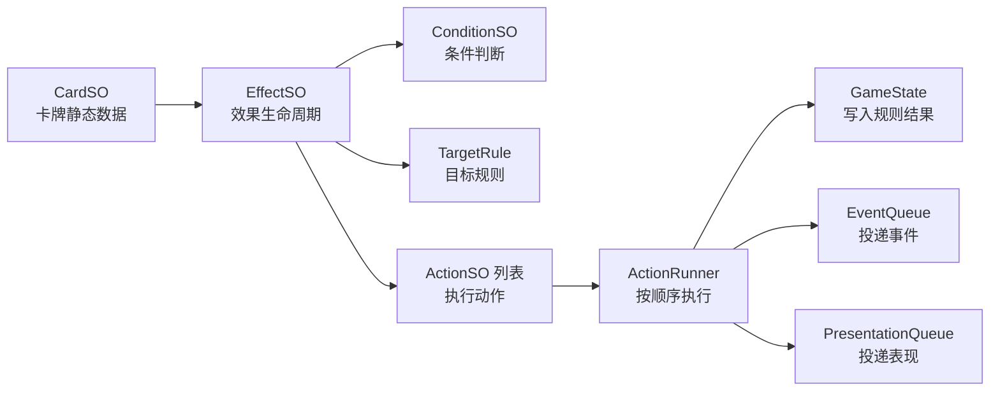
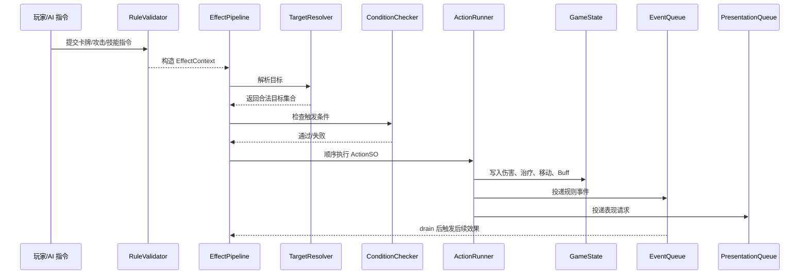
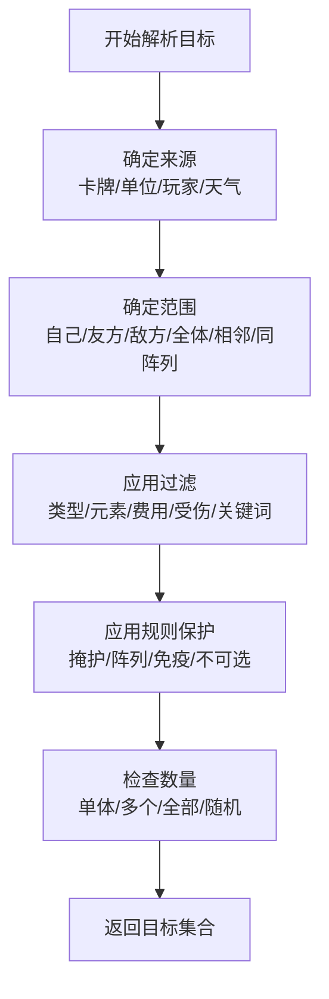
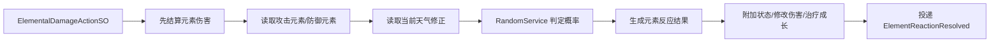
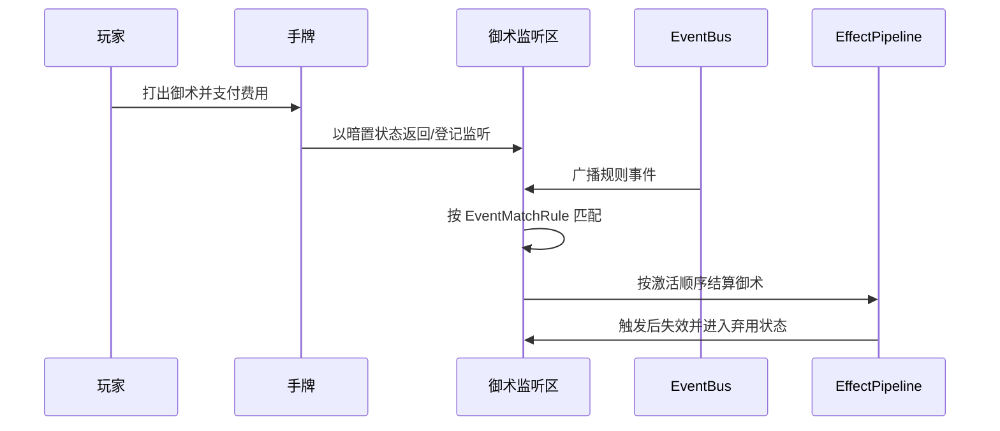
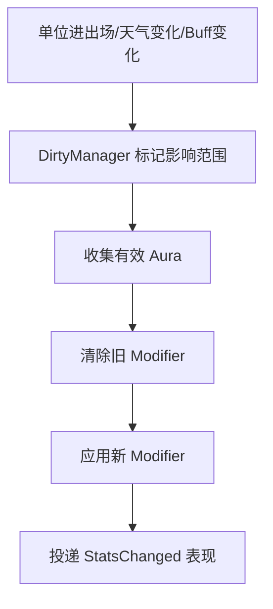

# 效果系统

效果系统是《妖斗牌》规则层的核心。它负责把卡牌文本转化为可配置、可测试、可复用的结算逻辑，覆盖派遣、法术、御术、亡语、天气、元素反应、Buff、光环等能力。

## 设计目标

1. **数据驱动**：大多数卡牌不写专属代码，通过 `EffectSO + ActionSO + ConditionSO` 组合完成。
2. **确定性结算**：同一初始状态、同一指令序列、同一随机种子，必须得到相同结果。
3. **可观测**：每次效果结算都能输出上下文、目标、成功/失败、生成事件和表现指令。
4. **可扩展**：新增元素、状态、关键词时优先新增 Action 或 Condition，不改主流程。
5. **表现解耦**：效果只产生规则结果和表现请求，不直接操作 UI。

## 效果模型图

### 静态数据与运行时上下文

| 对象 | 保存内容 | 生命周期 |
| --- | --- | --- |
| `CardSO` | 名称、费用、类型、元素、稀有度、卡图引用、效果列表。 | 编辑期资源，运行时只读。 |
| `EffectSO` | 触发时机、目标规则、条件、动作列表。 | 编辑期资源，运行时只读。 |
| `RuntimeCard` | 实例 ID、控制者、当前区域、当前攻血、Buff、临时标记。 | 单局对局内创建和销毁。 |
| `EffectContext` | 来源、操作者、目标、触发事件、随机服务、结算日志。 | 单次效果结算期间创建。 |
| `ActionResult` | 成功/失败、状态变化、生成事件、表现请求。 | 单个 Action 执行后返回。 |

## 三大效果生命周期

| 类型 | 用途 | 典型文本 | 结算入口 |
| --- | --- | --- | --- |
| `OneShotEffect` | 一次性结算。 | 派遣、法术、治疗、抽牌、预测天气、造成伤害。 | 打出卡牌、派遣成功、法术命中。 |
| `TriggeredPersistentEffect` | 持续监听事件，满足条件时触发。 | 御术、亡语、在场监听。 | `EventBus` 匹配事件后进入管线。 |
| `AuraEffect` | 持续影响数值或规则，随环境变化刷新。 | 全场 +1 攻、雨天水系增益、同阵列增益。 | Dirty 标记后批量重算 Modifier。 |

## 效果结算流程

### 结算顺序规则

1. **支付成本先于效果**：打出卡牌、攻击、移动和技能先支付法力，再进入效果。
2. **目标合法性先于支付**：若必须指定目标而无合法目标，不允许提交指令。
3. **妖怪派遣的特殊规则**：妖怪牌带有需要指向的派遣效果时，如果没有合法目标，派遣本身仍可执行，指向效果跳过。
4. **法术的严格目标规则**：法术若需要目标，必须有合法目标才能打出。
5. **状态变化先于事件广播**：例如伤害先扣血，再投递 `DamageResolved`，这样监听者读取到的是最新状态。
6. **死亡检查批量处理**：一批 Action 完成后统一检查死亡，避免同一单位在连锁中重复死亡。

## ActionSO 设计

| ActionSO | 参数 | 结果 |
| --- | --- | --- |
| `DealDamageActionSO` | 伤害值、伤害类型、是否可被护甲抵挡。 | 扣除生命/护甲，生成伤害事件。 |
| `ElementalDamageActionSO` | 元素、伤害值、是否允许元素反应。 | 造成伤害，并交给元素反应系统判定。 |
| `HealActionSO` | 治疗值。 | 仅恢复当前生命，封顶于当前最大生命；实际恢复量大于0才生成治疗事件，禁止超上限治疗。 |
| `ModifyHealthStatActionSO`（设计接口） | 生命成长值、持续时间。 | “生命值+N／+0/+N”同时增加当前与最大生命，生成属性变化事件，不生成治疗事件。 |
| `ModifyMaxHealthActionSO`（设计接口） | 最大生命修正值、持续时间。 | 仅用于明确写“生命上限／最大生命值+N”的效果；提高上限时不自动恢复当前生命。 |
| `DrawCardsActionSO` | 抽牌数量、抽牌玩家。 | 从牌库移动到手牌，处理爆手。 |
| `GrantKeywordActionSO` | 关键词、层数/持续时间。 | 增加关键词或刷新持续。 |
| `ApplyStatusActionSO` | 状态类型、持续回合、叠加规则。 | 添加点燃、熄灭、淤塞、熔蚀、根裂等。 |
| `WeatherActionSO` | 预测、清除、立即改变。 | 修改当前天气或预测天气。 |
| `MoveCardActionSO` | 来源区域、目标区域、过滤条件。 | 抽牌、弃牌、封除、征召。 |
| `IfConditionActionSO` | 条件、成功动作、失败动作。 | 形成分支效果。 |
| `ModifyManaActionSO` | 增减当前法力或上限。 | 改变资源状态。 |

### 生命数据与事件边界

- 运行时分别记录当前生命与最大生命；不能将二者合为一个字段，也不能用可超量治疗模拟属性成长。
- 对存活目标恢复N点：实际恢复量 = min(N, 最大生命 - 当前生命)，N为非负值。只增加当前生命；实际恢复0时不广播成功治疗事件。
- 获得+N生命值：原子地将最大生命与当前生命各增加N，不调用治疗动作，不广播治疗事件。允许跨过旧最大生命，结算后仍满足当前生命不大于新最大生命。
- 明确“最大生命+N，再恢复N”时执行上限修正、治疗两个动作；它包含真实治疗，事件语义不同于普通生命成长。
- 同时包含成长与恢复的牌逐项执行。例如2/3获得+0/+1并恢复1后为4/4，成长量1、实际治疗量1；3/3同样结算后为4/4，实际治疗量0。
- 上述新增接口名为技术设计建议；需在实际运行时代码中验证实现。具体文案与数值示例见[卡牌文本规范](../02-玩法设计/卡牌文本规范.md)。

### Action 编写约束

- Action 必须通过 `EffectContext` 访问状态和服务，不直接查找场景对象。
- Action 不直接播放动画，只能追加 `PresentationCommand`。
- Action 不吞掉异常。规则错误应带卡牌 ID、Effect ID、Action ID 输出日志。
- Action 可返回 `Skipped`，用于目标不存在、条件不满足、免疫等非错误情况。

## 目标解析

目标规则建议拆成可复用配置：

| 配置项 | 示例 |
| --- | --- |
| 目标阵营 | 自己、友方、敌方、双方。 |
| 目标类型 | 选手、妖怪、任意目标、战场格位、手牌、牌库。 |
| 位置范围 | 第一阵列、第二阵列、相邻、同列、全场。 |
| 过滤条件 | 费用不超过 2、火元素、受伤单位、拥有护甲。 |
| 选择方式 | 玩家选择、随机、全部、最高攻击、最低生命。 |
| 保护规则 | 是否受掩护影响、是否受阵列保护、是否可选不可攻击目标。 |

## 元素反应接入

元素反应不应写在普通伤害 Action 内，而是由 `ElementalDamageActionSO` 调用专门的 `ElementReactionSystem`。

### 判定输入

| 输入 | 说明 |
| --- | --- |
| 攻击元素 | 来自伤害 Action、单位基础元素或法术配置。 |
| 防御元素 | 来自目标单位元素；选手默认无元素，除非选手牌配置。 |
| 伤害来源 | 攻击、法术、状态、天气。不同来源可限制可触发反应。 |
| 当前天气 | 平常天、艳阳天、雨天。影响概率或强制触发/禁止。 |
| 随机状态 | 使用对局随机服务，不使用 `UnityEngine.Random`。 |

### 反应输出

| 反应 | 技术实现 |
| --- | --- |
| 点燃 | `ApplyStatusActionSO(Ignite, 2 turns, RefreshOnly)` |
| 熄灭 | `ApplyStatusActionSO(Extinguish, 2 turns, RefreshOnly)` |
| 吸收 | `ModifyMaxHealthActionSO + HealActionSO` |
| 淤塞 | `ApplyStatusActionSO(Silt, 2 turns)` 并标记 Aura Dirty。 |
| 劈斩 | 在本次伤害上下文中增加护甲穿透 Modifier。 |
| 熔蚀 | `ApplyStatusActionSO(Smelt, until next attack, max 2 turns)` |
| 根裂 | `ApplyStatusActionSO(RootBreak, until next damage)` |

## 御术触发

御术是暗置反制，不是持续收益引擎。

### 御术规则

- 激活时立即支付费用。
- 激活后进入监听区，表现上可暗置显示。
- 多个御术同时满足时，按激活顺序结算。
- 同一事件批次中，御术触发后应从监听列表移除，避免重复触发。
- 御术触发产生的新事件进入下一批次，避免当前列表遍历被修改。

## 光环与 Dirty 刷新

Aura 不直接修改基础数值，而是生成 Modifier。

### Modifier 分层

| 层级 | 示例 | 刷新方式 |
| --- | --- | --- |
| 基础值 | 卡牌印刷攻血。 | 不刷新。 |
| 永久成长 | 吸收增加生命上限。 | 状态变化时写入运行时数据。 |
| 临时 Buff | 本回合 +2 攻。 | 回合结束清理。 |
| 光环 Modifier | 同阵列妖怪 +1 攻。 | Dirty 批量重算。 |
| 状态压制 | 淤塞使在场效果失效。 | 状态增删时刷新。 |

## 错误处理和日志

效果系统至少输出以下日志字段：

| 字段 | 示例 |
| --- | --- |
| `matchId` | 本地对局可用临时 GUID。 |
| `turn` | 第 5 回合。 |
| `source` | 卡牌实例 ID、卡牌配置 ID。 |
| `effectId` | `fx_fire_spell_ignite_01` |
| `actionId` | `apply_ignite` |
| `targets` | 目标实例 ID 列表。 |
| `result` | Success / Failed / Skipped。 |
| `events` | 本 Action 生成的事件列表。 |

## 测试清单

| 用例 | 验证点 |
| --- | --- |
| 法术无目标不可打出 | `PlayCardCommand` 被拒绝，不扣费。 |
| 妖怪派遣无目标仍可上场 | 妖怪进入战场，指向派遣效果跳过。 |
| 点燃刷新不叠加 | 多次点燃只刷新持续回合，不产生多层伤害。 |
| 御术按激活顺序触发 | 同一事件触发多个御术时顺序稳定。 |
| 淤塞关闭在场效果 | 光环从 Modifier 中移除，状态结束后恢复。 |
| 随机元素反应可复现 | 固定随机种子下结果稳定。 |
| 死亡只结算一次 | 同一单位在同一批次内不重复触发亡语。 |
