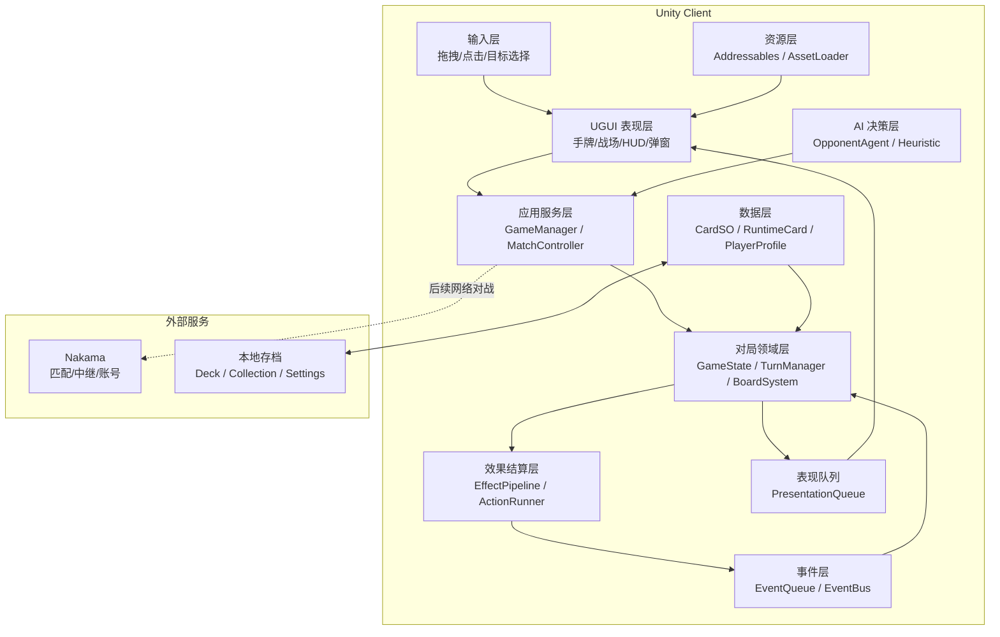
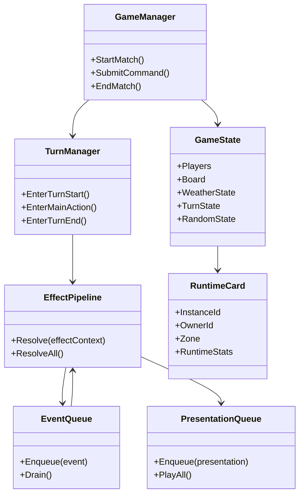
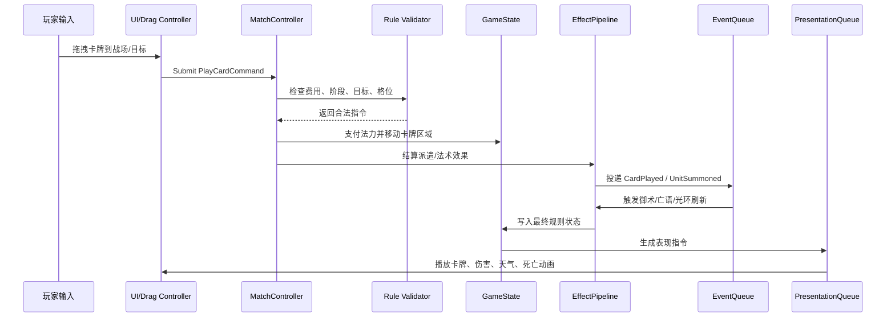
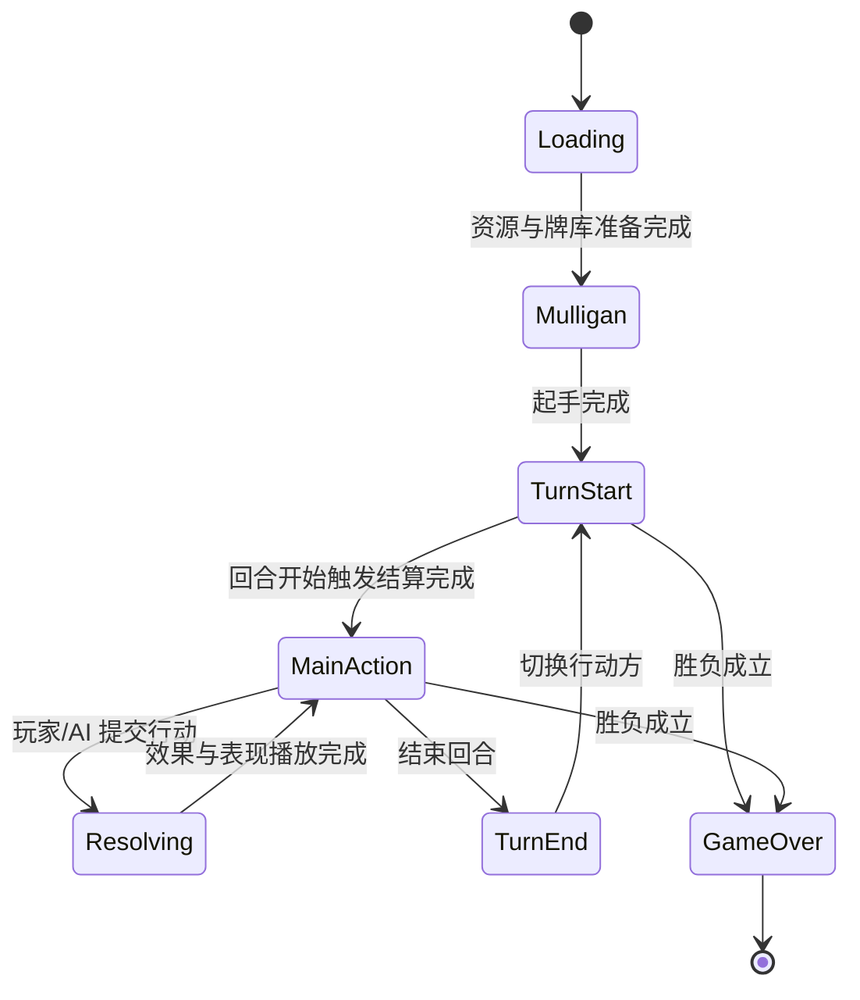

# 架构概述

本章节描述《妖斗牌》商业版的客户端技术架构。当前目标是先支撑完整单机 AI 对战、卡牌收藏、构筑和演出流程，同时为后续 Nakama 网络对战保留确定性结算、快照同步和断线重连能力。

## 技术栈

| 层级 | 方案 | 说明 |
| --- | --- | --- |
| 引擎 | Unity 2022.3.62f1 LTS | 以移动端优先，PC 兼容为目标。 |
| 渲染 | URP | 统一移动端光照、后处理、特效预算。 |
| UI | UGUI | 对局内 HUD、手牌、战场、卡组编辑器。 |
| 动画 | DOTween | 卡牌移动、翻转、拖拽回弹、伤害数字、天气切换。 |
| 数据 | ScriptableObject + JSON Save | 卡牌静态数据使用 SO，玩家收藏和卡组使用 JSON 存档。 |
| 资源 | Addressables | 卡图、特效、音频、卡牌预制体按标签异步加载。 |
| 网络 | Nakama | 后续用于 Matchmaker、Relay、玩家账号和排行榜。 |
| 测试 | EditMode + PlayMode Tests | 规则逻辑优先 EditMode，演出和场景流程使用 PlayMode。 |

## 总体架构图

### 分层职责

| 层级 | 职责 | 禁止事项 |
| --- | --- | --- |
| 表现层 | 展示状态、播放动画、收集玩家意图。 | 不直接修改 GameState，不直接结算卡牌效果。 |
| 应用服务层 | 编排对局流程、提交玩家指令、切换阶段。 | 不写具体卡牌规则，不依赖具体 UI 组件。 |
| 对局领域层 | 维护确定性状态，包括玩家、手牌、牌库、战场、天气、法力。 | 不播放动画，不访问 Addressables。 |
| 效果结算层 | 按 EffectSO、ActionSO、ConditionSO 执行卡牌效果。 | 不直接创建 UI，不依赖 MonoBehaviour 生命周期。 |
| 事件层 | 统一广播规则事件，驱动御术、亡语、光环刷新和表现。 | 不在事件回调中无限递归结算。 |
| 表现队列 | 将规则结果转成可播放的表现指令。 | 不决定规则结果，不修正数值。 |
| 数据层 | 静态卡牌定义、运行时卡牌实例、玩家存档。 | 不把运行时血量、Buff 写回 CardSO。 |

## 运行时核心对象

### 核心数据原则

1. **静态数据和运行时数据分离**：`CardSO` 只保存可编辑的卡牌模板，`RuntimeCard` 保存对局中的实例 ID、当前血量、Buff、控制者、所在区域等。
2. **规则结算和表现播放分离**：所有数值变化先在 `GameState` 中完成，再投递 `PresentationCommand` 给表现队列播放。
3. **所有随机数集中管理**：抽牌、元素反应、随机征召、AI 随机权重统一走 `RandomService`，记录种子与调用序号，方便复盘和网络同步。
4. **卡牌效果数据驱动**：卡牌文本对应 `EffectSO + ActionSO + ConditionSO` 组合，减少为单卡写硬编码逻辑。
5. **Feature Flag 控制风险**：网络对战、御术高级交互、复杂天气演出、付费系统等通过开关分阶段接入。

## 对局数据流

### 指令提交模型

玩家和 AI 都不直接调用规则系统，而是提交统一指令：

| 指令 | 主要参数 | 校验点 |
| --- | --- | --- |
| `PlayCardCommand` | 玩家、手牌实例、目标格位、目标对象 | 当前阶段、费用、目标、手牌归属、格位空闲。 |
| `AttackCommand` | 攻击者、目标 | 是否可攻击、攻击费用、阵列保护、掩护、目标合法性。 |
| `MoveUnitCommand` | 单位、目标格位 | 是否已移动、是否已行动、费用、目标格位合法。 |
| `ActivateSkillCommand` | 单位、技能、目标 | 技能冷却、费用、目标、是否被扼制/淤塞。 |
| `EndTurnCommand` | 玩家 | 是否当前行动方、是否存在锁定结算。 |

指令校验必须只读当前 `GameState`。通过校验后，应用服务层生成 `ActionContext` 并进入效果管线。这样可以让本地玩家、AI 和网络远端玩家复用同一套规则入口。

## 程序集划分

| 程序集 | 内容 | 依赖方向 |
| --- | --- | --- |
| `ThirdBattleLine.Runtime` | 对局规则、数据模型、效果系统、事件系统。 | 不依赖 Presentation 和 Unity UI。 |
| `ThirdBattleLine.Presentation` | 战场视图、卡牌视图、动画队列、音效触发。 | 依赖 Runtime。 |
| `ThirdBattleLine.Networking` | Nakama 客户端、同步协议、快照编码。 | 依赖 Runtime，尽量不依赖 Presentation。 |
| `ThirdBattleLine.Editor` | 卡牌编辑器、数据校验、批量导入工具。 | 依赖 Runtime。 |
| `ThirdBattleLine.Tests` | EditMode/PlayMode 测试。 | 依赖 Runtime，可按需依赖 Presentation。 |

## 模块清单

| 模块 | 首版目标 | 关键文件/类型建议 |
| --- | --- | --- |
| 回合系统 | 支撑回合开始、主行动、回合结束、胜负检查。 | `TurnManager`, `TurnPhase`, `TurnContext` |
| 法力系统 | 回合开始增长并回满，行动消耗。 | `ManaSystem`, `SpendManaActionSO` |
| 战场系统 | 2×5 或当前定义的前后排格位、阵列保护、移动。 | `BoardState`, `BoardSlot`, `BoardRules` |
| 效果系统 | OneShot、TriggeredPersistent、Aura 三类效果。 | `EffectSO`, `ActionSO`, `ConditionSO` |
| 元素系统 | 元素伤害、天气修正、状态附加。 | `ElementReactionSystem`, `WeatherState` |
| 御术系统 | 暗置监听、事件匹配、按激活顺序触发。 | `SecretTrapSystem`, `EventMatchRule` |
| AI 系统 | 可完成出牌、攻击、移动、结束回合。 | `OpponentAgent`, `ActionScorer` |
| 存档系统 | 收藏、卡组、设置、进度版本迁移。 | `JsonDeckStorage`, `PlayerProfileSave` |
| 资源系统 | 卡图、预制体、音频按需加载和缓存释放。 | `IAssetLoader`, `AddressablesAssetLoader` |

## 对局状态生命周期

### 阶段锁

对局在 `Resolving` 阶段必须锁定玩家输入，避免玩家在动画播放或事件连锁期间追加非法指令。UI 可以继续响应查看卡牌详情、打开设置等非规则操作，但不能提交出牌、攻击、移动和结束回合。

## 设计模式

1. **Service Locator 仅用于基础服务查找**：适合 `RandomService`、`AudioService`、`AssetLoader`、`SaveService`。对局核心系统建议通过构造或初始化显式注入，避免隐性依赖过多。
2. **组合优于继承**：卡牌能力通过 `EffectSO + ActionSO + ConditionSO` 拼装；只有生命周期差异进入 `EffectSO` 子类。
3. **管道 + 队列混合编排**：效果结算用管道保证顺序，事件和表现用队列避免递归失控。
4. **Dirty 刷新光环**：Aura 不在每帧重算，而是在单位进出场、天气变化、Buff 改变时标记 Dirty，批量刷新。
5. **快照优先的网络同步**：不为每个效果写反向 Undo。网络异常时通过权威快照覆盖本地状态并重播必要表现。

## 关键风险与规避

| 风险 | 表现 | 规避方案 |
| --- | --- | --- |
| 事件递归失控 | 亡语触发亡语、御术触发御术导致无限结算。 | `EventQueue` 设置结算批次、深度上限和强制排空日志。 |
| 表现和规则不同步 | UI 动画还没播完，状态已经进入下一阶段。 | `PresentationQueue` 提供完成回调，`MatchController` 等待关键表现完成再解锁输入。 |
| 卡牌数据膨胀 | 单卡硬编码导致维护困难。 | 数据驱动 ActionSO，新增效果先归类到通用 Action。 |
| 移动端内存超预算 | 卡图、特效、音频常驻过多。 | Addressables 标签加载，卡池预热，离开页面释放非必要资源。 |
| 网络后接入困难 | 单机逻辑大量依赖 UI 和本地时间。 | Runtime 层保持纯规则入口，所有玩家行为统一走 Command。 |

## 首版验收标准

- 一局 AI 对战可以从加载进入对局，完成出牌、攻击、移动、天气、元素反应、死亡、回合切换和胜负结算。
- 所有规则变化可以在不依赖 UI 的 EditMode 测试中复现。
- 任意卡牌效果结算后，`GameState`、事件日志和表现队列三者顺序一致。
- 对局中不存在每帧全量扫描卡牌、Buff、光环的逻辑。
- 在移动端目标机型上，对局主界面不卡死、不出现资源引用丢失、不出现输入穿透。

