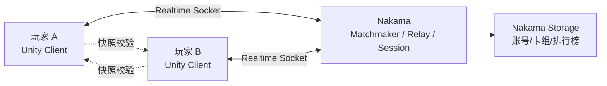
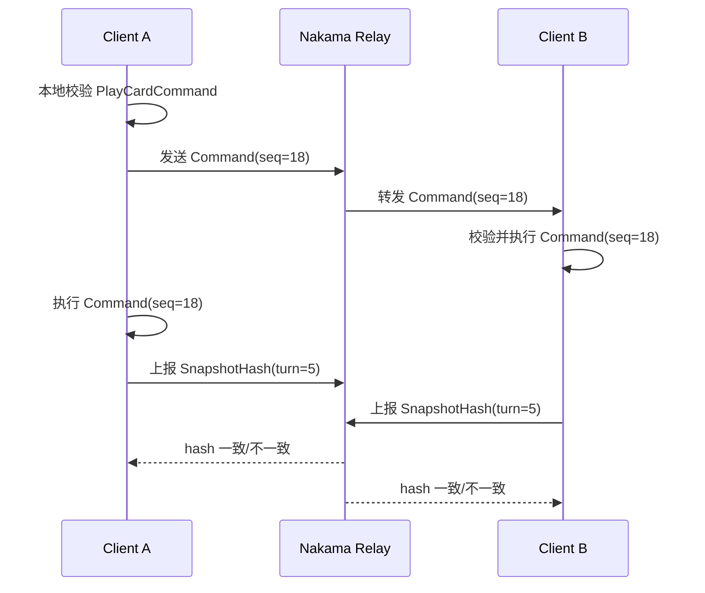
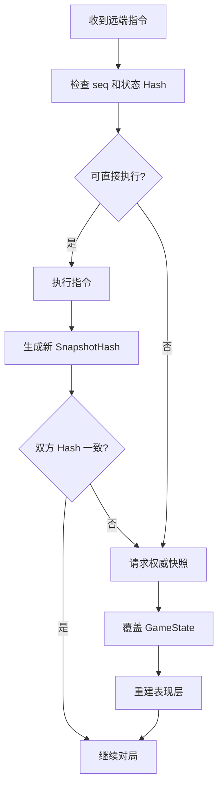
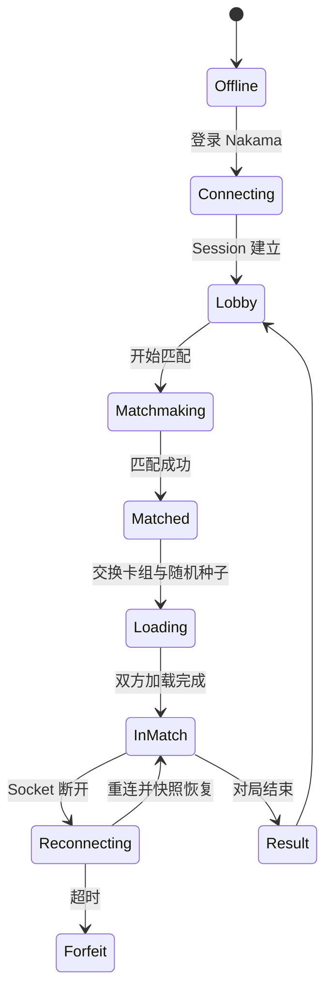
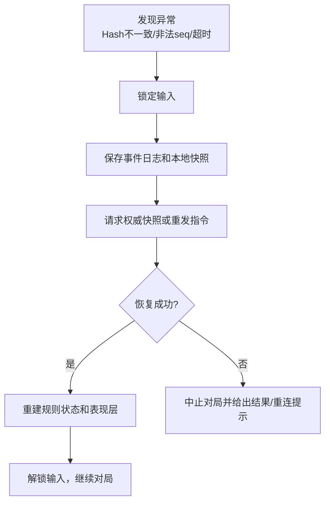

# 网络方案

当前商业版首要目标是完整单机 AI 对战，网络对战作为后续扩展方向预留。技术方案采用 Nakama 作为账号、匹配、中继和排行榜基础设施；客户端规则层保持确定性，网络层只负责指令传输、快照校验和异常恢复。

## 网络目标

| 阶段 | 目标 | 说明 |
| --- | --- | --- |
| M1 | 本地规则确定性 | 同一指令序列和随机种子可复现同一结果。 |
| M2 | 本地伪联机 | 双端进程或模拟客户端通过指令同步跑同一局。 |
| M3 | Nakama Relay 对战 | 匹配、房间、指令同步、掉线重连。 |
| M4 | 权威服务端 | 关键比赛由服务端校验或托管规则，减少作弊。 |

## 总体拓扑



首版联机可以采用 Relay 模式：Nakama 转发双方指令，不在服务端完整跑规则。这样开发成本较低，但必须做快照校验和异常处理。竞技模式上线前，再评估是否将规则核心迁移到权威服务端或使用托管校验。

## 同步模型



### 为什么不做逐条 Undo

卡牌效果存在御术、亡语、元素反应、天气、随机征召等连锁。为每个 Action 写反向 Undo 会带来极高复杂度，而且很容易漏掉表现和派生事件。网络异常时采用更稳妥的方案：

1. 正常情况下双方按指令同步推进。
2. 每个关键点生成 `SnapshotHash`。
3. Hash 不一致时，请求完整快照。
4. 用权威快照覆盖本地规则状态。
5. 清空未完成表现，按快照状态重建战场 UI。

## 指令协议

所有网络操作都传输玩家意图，而不是传输每个伤害数字。

| 字段 | 说明 |
| --- | --- |
| `matchId` | 对局 ID。 |
| `playerId` | 发起玩家。 |
| `seq` | 玩家维度递增序号。 |
| `turn` | 当前回合号。 |
| `phase` | 当前阶段。 |
| `commandType` | PlayCard / Attack / Move / ActivateSkill / EndTurn。 |
| `payload` | 卡牌实例、目标格位、目标实例等。 |
| `clientStateHash` | 发起前的状态 Hash，可用于快速发现分歧。 |
| `timestamp` | 客户端时间，仅用于日志和延迟评估，不参与规则。 |

## 快照协议



### 快照内容

| 内容 | 说明 |
| --- | --- |
| 玩家状态 | 生命、法力、最大法力、手牌数、牌库数。 |
| 公开区域 | 战场单位、弃用状态、场外牌堆、公共封存卡组数量。 |
| 私有区域 | 手牌、牌库顺序。只发给所属玩家或加密处理。 |
| 天气状态 | 当前天气、剩余轮次、预测天气。 |
| 回合状态 | 当前玩家、回合号、阶段、行动锁。 |
| 随机状态 | 随机种子、调用序号。 |
| 监听状态 | 已激活御术的顺序和可公开信息。 |

## 随机数同步

| 场景 | 处理 |
| --- | --- |
| 抽牌 | 牌库洗牌在开局由种子确定，之后只移动牌库顶部。 |
| 元素反应 | 双端使用 `RandomService.Roll(reactionContextId)`，调用顺序必须一致。 |
| 随机征召 | 从公共封存卡组按稳定排序后随机索引。 |
| AI 随机 | 单机 AI 可使用独立随机；联机不允许 AI 参与玩家对战决策。 |

不要在规则层使用 `UnityEngine.Random`、系统时间、帧时间或对象遍历的不稳定顺序。

## 联机状态机



## 断线重连

| 情况 | 处理 |
| --- | --- |
| 短暂断线 | 客户端暂停提交指令，重连后拉取最新快照和缺失事件。 |
| 对手断线 | 本地显示等待倒计时；超过时间判负或交给 AI 托管，取决于模式。 |
| 本地 Hash 不一致 | 请求对手或服务端快照，覆盖本地并重建 UI。 |
| 指令丢包/乱序 | 根据 `seq` 缓存乱序指令，缺失时请求重发。 |

## 作弊与校验

Relay 模式无法完全阻止作弊，但可以降低风险：

| 风险 | 首版处理 | 后续处理 |
| --- | --- | --- |
| 客户端改费用/数值 | 双端按相同卡牌版本校验，Hash 不一致中断。 | 服务端权威规则。 |
| 非法指令 | 接收端重新校验，不合法则拒绝并上报。 | 服务端校验。 |
| 改随机结果 | 随机调用序号进入 SnapshotHash。 | 服务端发放随机结果。 |
| 改收藏/卡组 | 卡组来自 Nakama Storage 或本地签名存档。 | 服务端卡组校验。 |

## 与单机架构的接口

网络层只依赖以下接口：

```text
IMatchCommandSerializer
IRuleCommandValidator
IMatchCommandExecutor
IGameStateSnapshot
IRandomStateProvider
```

UI 不直接依赖 Nakama。对局开始时由 `MatchController` 注入 `ICommandSource`：

| 模式 | `ICommandSource` |
| --- | --- |
| 本地玩家 vs AI | `LocalPlayerCommandSource + AiCommandSource` |
| 本地双人测试 | `LocalCommandSource + SimulatedRemoteCommandSource` |
| 联机对战 | `LocalCommandSource + NakamaRemoteCommandSource` |

## 错误恢复流程



## 测试清单

| 用例 | 验证点 |
| --- | --- |
| 双端同种子同指令 | 每回合 SnapshotHash 一致。 |
| 指令乱序 | 客户端缓存后按 seq 执行。 |
| 指令缺失 | 客户端请求重发，不直接跳过。 |
| Hash 不一致 | 能拉取快照并重建 UI。 |
| 断线重连 | 重连后恢复到同一回合阶段。 |
| 非法远端指令 | 被接收端拒绝并记录日志。 |

