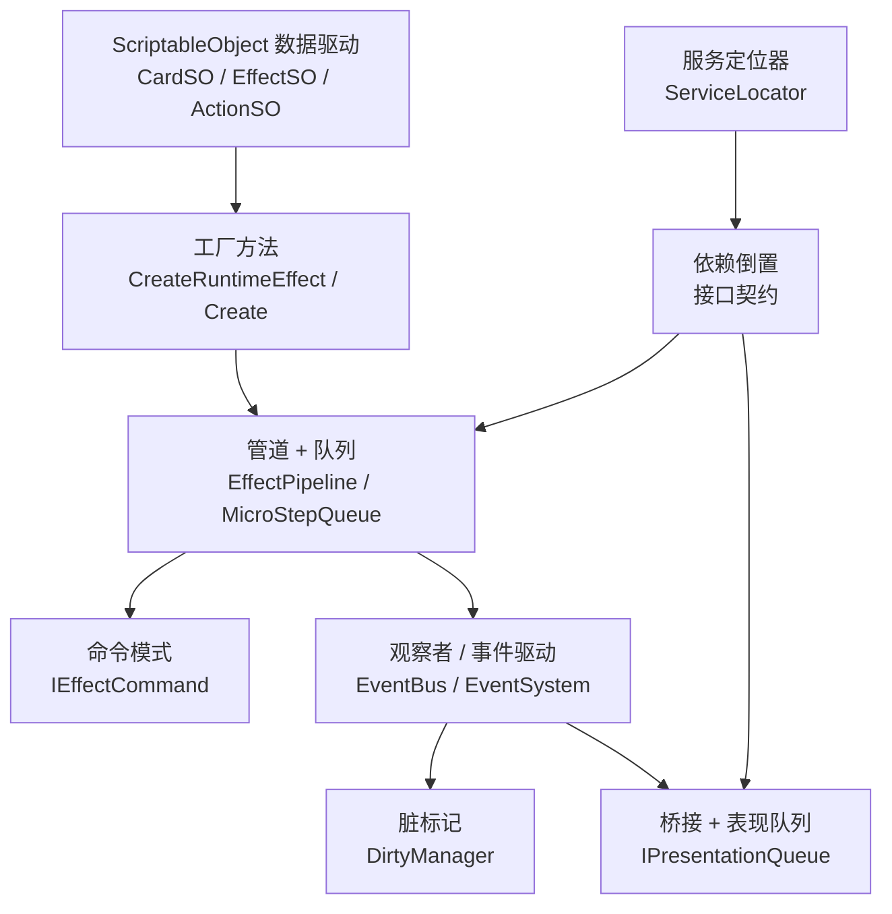

# 设计模式

本章节梳理《妖斗牌》项目中已经落地的设计模式，标注其应用场景、核心代码位置和使用约束。

## 模式总览

| 模式 | 应用位置 | 核心目的 |
| --- | --- | --- |
| 单例 | GameManager / GameBootstrapper / EventBus | 全局唯一入口，简化访问 |
| 服务定位器 | ServiceLocator | 解耦模块间硬引用，支持接口级查找 |
| 观察者 / 事件驱动 | EventBus / EventSystem | 规则层与表现层、音效层解耦 |
| 命令 | IEffectCommand / ITurnCommand | 将操作封装为对象，支持排队与延迟执行 |
| 状态机 | StartupStateMachine / 对局生命周期 | 管控启动与对局阶段的合法流转 |
| 管道 + 队列 | EffectPipeline / MicroStepQueue / PresentationQueue | 保证效果结算顺序，避免递归失控 |
| 工厂方法 | EffectSO.CreateRuntimeEffect / EffectActionSO.Create | 由配置资产创建运行时实例 |
| 策略 | AI 决策链 / ConditionSO / TargetFilterSO | 可插拔的算法族，运行时切换 |
| 模板方法 | EffectSO / RuntimeEffect / PresentationEvent | 抽象基类定义骨架，子类实现差异 |
| 数据驱动 | CardSO / EffectSO / ActionSO / ConditionSO | 策划通过 Inspector 配置，减少硬编码 |
| 对象池 | AudioEmitterPool | 复用高频创建/销毁对象，降低 GC |
| 脏标记 | DirtyManager / AuraEffect | 延迟批量刷新，避免逐帧全量重算 |
| 桥接 | RuntimeBridgeServices / ICardViewHandle / IPresentationQueue | 隔离抽象与实现，支持程序集拆分 |
| 依赖倒置 | ITurnQuery / IEffectPipeline / IGameStateAccess | 业务代码依赖接口而非具体类 |

---

## 1. 单例模式（Singleton）

### 应用场景

需要在整个应用或单局生命周期内提供唯一访问入口的管理器。

### 项目实现

```csharp
// GameManager.cs
public class GameManager : MonoBehaviour
{
    public static GameManager Instance { get; private set; }

    private void Awake()
    {
        if (Instance != null && Instance != this)
        {
            Destroy(gameObject);
            return;
        }
        Instance = this;
    }
}
```

### 使用清单

| 类 | 生命周期 | 说明 |
| --- | --- | --- |
| `GameManager` | 单局（随 FieldScene） | 对局核心入口，持有 EventSystem、TurnManager |
| `GameBootstrapper` | 全局（DontDestroyOnLoad） | 商业化启动流程唯一入口 |
| `EventBus.Instance` | 静态属性 | 规则事件总线，非 MonoBehaviour |
| `PlacementHandler` | 单局 | 卡牌部署交互管理 |

### 约束

- GameManager 跟随单局场景生命周期，不做 DontDestroyOnLoad，避免跨局状态污染。
- 新代码优先通过 `ServiceLocator` 接口访问，Instance 仅作向后兼容入口。

---

## 2. 服务定位器模式（Service Locator）

### 应用场景

模块间需要解耦硬引用，通过类型查找获取服务实例。适合基础服务（日志、音频、资源加载、存档）和跨程序集边界访问。

### 项目实现

```csharp
// Core/ServiceLocator.cs
public static class ServiceLocator
{
    private static readonly Dictionary<Type, object> _services = new();

    public static void Register<T>(T service) { ... }
    public static bool TryRegister<T>(T service) { ... }
    public static void RegisterOrReplace<T>(T service) { ... }
    public static T Get<T>() { ... }
    public static bool TryGet<T>(out T service) { ... }
    public static bool Unregister<T>(T expected = default) { ... }
    public static void Clear() { ... }
}
```

### 典型注册点

| 服务 | 注册时机 | 注销时机 |
| --- | --- | --- |
| `IEffectPipeline` | EffectPipeline.Awake | EffectPipeline.OnDestroy |
| `ITurnQuery` / `ITurnCommand` | TurnManager.Awake | TurnManager.OnDestroy |
| `IGameStateAccess` | GameState 初始化 | 对局结束 |
| `IPresentationQueue` | PresentationQueue 初始化 | 场景切换 |
| `DirtyManager` | DirtyManager.Awake | DirtyManager.OnDestroy |

### 约束

- 对局核心系统建议通过构造或初始化显式注入，ServiceLocator 仅用于基础服务查找。
- `RegisterOrReplace` 用于跨场景重进的幂等注册，避免重复注册抛异常。
- `Unregister` 支持传入 expected 实例做引用校验，防止误删新注册。

---

## 3. 观察者 / 事件驱动模式（Observer / Event-Driven）

### 应用场景

规则层产出事件，表现层、音效层、御术系统、成就系统等订阅消费，实现完全解耦。

### 项目实现

项目采用双层事件体系：

**EventBus（规则层事件总线）**

```csharp
// GamePlay/Card/EventQueue.cs
public class EventBus
{
    public static EventBus Instance { get; } = new EventBus();

    public void Register(GameEventType type, Action<GameEventData> handler,
        RuntimeCard ownerCard, int priority, string debugName) { ... }
    public void Unregister(GameEventType type, Action<GameEventData> handler) { ... }
    public void Invoke(GameEventData data) { ... }
}
```

- 支持优先级排序（Priority 降序 → 注册序号升序）。
- 御术牌等延迟触发器按暗置顺序执行。
- Invoke 结束后桥接转发到 EventSystem，供音效/UI 消费。

**EventSystem（表现层事件分发）**

```csharp
// Core/EventSystem.cs
public class EventSystem : MonoBehaviour
{
    public void Register(GameEventType eventType, Action<GameEventData> handler) { ... }
    public void Trigger(GameEventType eventType, GameEventData data) { ... }
}
```

### 约束

- 禁止在事件回调中无限递归结算，EventQueue 设有深度上限。
- 场景重进时调用 `ClearAll()` 清空所有订阅，防止跨局残留。

---

## 4. 命令模式（Command）

### 应用场景

将操作封装为对象，支持排队、延迟执行、诊断追踪。

### 项目实现

**效果命令**

```csharp
// Core/MicroStepQueue.cs
public interface IEffectCommand
{
    EffectStep Step { get; }
    string DebugName { get; }
    IEnumerator Execute(MonoBehaviour runner);
}

public sealed class EffectRoutineCommand : IEffectCommand { ... }
public sealed class EffectRuleCommand : IEffectCommand { ... }
```

**回合命令**

```csharp
// Core/Interfaces/ITurnCommand.cs
public interface ITurnCommand
{
    void EndTurn();
}
```

### 使用方式

- `EffectPipeline.EnqueueCommand(command)` 将命令压入 `EffectCommandStack`。
- 命令按 FIFO 顺序逐个执行，每个命令携带 `EffectStep` 用于诊断追踪。
- 业务代码通过 `ITurnCommand` 接口结束回合，不直接访问 TurnManager.Instance。

---

## 5. 状态机模式（State Machine）

### 应用场景

管控游戏启动流程和对局生命周期的合法状态流转。

### 项目实现

**启动状态机**

```csharp
// Commerce/Bootstrap/StartupStateMachine.cs
public sealed class StartupStateMachine
{
    private StartupState _currentState = StartupState.ColdStart;

    private static readonly Dictionary<StartupState, StartupState[]> ValidTransitions = new()
    {
        { StartupState.ColdStart, new[] { StartupState.PrivacyConsent, StartupState.Failed } },
        { StartupState.PrivacyConsent, new[] { StartupState.PlatformInitialize, StartupState.Failed } },
        // ...
    };

    public bool TryTransition(StartupState targetState) { ... }
    public void Fail(string errorMessage = null) { ... }
}
```

状态流转：`ColdStart → PrivacyConsent → PlatformInitialize → PlatformLogin → BackendLogin → ComplianceCheck → LoadRemoteConfig → LoadPlayerData → EnterMainMenu`

**对局生命周期**

`Loading → Mulligan → TurnStart → MainAction → Resolving → TurnEnd → GameOver`

### 约束

- 状态转换严格校验合法性，非法转换返回 false 并打 Warning。
- Failed 状态支持重试回到 PrivacyConsent。
- 每次转换触发 `OnTransition` 事件，便于 UI 进度条和日志追踪。

---

## 6. 管道 + 队列模式（Pipeline + Queue）

### 应用场景

卡牌效果结算需要严格顺序执行，同时避免事件连锁导致递归栈溢出。

### 项目实现

**EffectPipeline（效果管道）**

```csharp
// Core/EffectPipeline.cs
public class EffectPipeline : MonoBehaviour, IEffectPipeline
{
    private readonly Queue<EffectStep> _effectQueue = new();
    private readonly EffectCommandStack _commandStack = new();

    public void EnqueueEffect(IEnumerator effectRoutine) { ... }
    public void EnqueueCommand(IEffectCommand command) { ... }
    public IEnumerator ProcessQueue() { ... }
}
```

**MicroStepQueue（微步队列）**

```csharp
// Core/MicroStepQueue.cs
public class MicroStepQueue
{
    private readonly Queue<EffectStep> _steps = new();
    public int SafetyLimit { get; set; } = 2048;

    public void Enqueue(EffectStep step) { ... }
    public IEnumerator DrainAll(MonoBehaviour runner, Func<IEnumerator> onStepCompleted = null) { ... }
}
```

**PresentationQueue（表现队列）**

```csharp
// Core/Presentation/IPresentationQueue.cs
public interface IPresentationQueue
{
    void Enqueue(PresentationEvent evt);
    bool TryDequeue(out PresentationEvent evt);
    bool HasPending { get; }
    void Clear();
}
```

### 设计要点

- 效果结算用管道保证顺序，事件和表现用队列避免递归失控。
- 逻辑层禁止 `yield return` 表现协程，只投递 `PresentationEvent` 到队列。
- SafetyLimit 熔断机制防止无限循环（默认 2048 步）。
- 每个微步完成后可执行事件 flush（`onStepCompleted` 回调）。

---

## 7. 工厂方法模式（Factory Method）

### 应用场景

由 ScriptableObject 配置资产创建对应的运行时实例，实现配置与运行时分离。

### 项目实现

```csharp
// EffectSO.cs
public abstract class EffectSO : ScriptableObject
{
    public abstract RuntimeEffect CreateRuntimeEffect();
}

// EffectActionSO.cs
public abstract class EffectActionSO : ScriptableObject
{
    public abstract IEffectAction Create();
}
```

### 使用方式

- 策划在 Inspector 中配置 `EffectSO` 子类资产。
- 运行时调用 `CreateRuntimeEffect()` 生成 `RuntimeEffect` 实例，绑定到 `RuntimeCard`。
- `EffectActionSO.Create()` 生成轻量无 Mono 的 `IEffectAction` 运行时执行体。

---

## 8. 策略模式（Strategy）

### 应用场景

AI 决策、条件判断、目标过滤等需要可插拔算法族的场景。

### 项目实现

**AI 决策链（可配置策略组合）**

```
AIPlayerController
├── AIActionGenerator   → 生成候选行动
├── AIRuleFilter        → 规则过滤非法行动
├── AIActionEvaluator   → 启发式 + 沙盒推演评分
└── AIActionExecutor    → 执行最优行动
```

- 沙盒推演可通过 `ConfigureSandbox(enabled, weight)` 运行时开关。
- 难度档 `AIDifficultySO` 可覆盖决策参数。

**条件策略**

```csharp
// ConditionSO.cs
public abstract class ConditionSO : ScriptableObject
{
    public abstract bool IsMet(EffectContext ctx, RuntimeCard target);
}
```

**目标过滤策略**

```csharp
// TargetFilterSO.cs
public abstract class TargetFilterSO : ScriptableObject
{
    public abstract bool IsMatch(EffectContext context, RuntimeCard target);
}
```

### 使用方式

- 每个 `EffectSO` 可配置多个 `ConditionSO` 和 `TargetFilterSO`，在 Inspector 中自由组合。
- 新增条件/过滤器只需创建新的 ScriptableObject 子类，无需修改效果执行逻辑。

---

## 9. 模板方法模式（Template Method）

### 应用场景

抽象基类定义算法骨架，子类只需实现差异部分。

### 项目实现

| 抽象基类 | 骨架方法 | 子类实现 |
| --- | --- | --- |
| `EffectSO` | 目标配置、触发配置、条件列表 | `CreateRuntimeEffect()` |
| `RuntimeEffect` | 持有 SourceSO 引用 | `BuildRoutine(EffectContext)` |
| `EffectActionSO` | 优先级、描述 | `Create()` |
| `ConditionSO` | CanUseDuringTargeting 虚属性 | `IsMet()` |
| `TargetFilterSO` | CanUseDuringTargeting 虚属性 | `IsMatch()` |
| `PresentationEvent` | SequenceId、CreatedAtFrame、Describe | `Kind` 属性 |

### 示例

```csharp
// RuntimeEffect.cs
public abstract class RuntimeEffect : IRuntimeEffect
{
    public EffectSO SourceSO;
    protected RuntimeEffect(EffectSO source) { SourceSO = source; }
    public abstract IEnumerator BuildRoutine(EffectContext ctx);
}
```

---

## 10. 数据驱动模式（Data-Driven / ScriptableObject）

### 应用场景

卡牌静态数据、效果配置、条件配置、目标过滤、AI 难度、天气、关卡等全部使用 ScriptableObject 资产。

### 项目实现

```csharp
// CardSO.cs
public class CardSO : ScriptableObject
{
    public CardData cardData;
    public List<KeyWordType> keyWords;
    public List<EffectSO> castEffects;
    public List<EffectSO> deathEffects;
    public List<EffectSO> persistentEffects;
    public CardViewType viewType;
    public WuXingElement nativeElement;
}
```

### 设计要点

- 静态数据（CardSO）和运行时数据（RuntimeCard）严格分离。
- 卡牌能力通过 `EffectSO + ActionSO + ConditionSO` 组合拼装，组合优于继承。
- 运行时血量、Buff 等不回写 CardSO。
- 新增卡牌效果只需创建 SO 资产并配置，无需修改引擎代码。

---

## 11. 对象池模式（Object Pool）

### 应用场景

高频创建/销毁的对象（音频发射器、粒子、伤害飘字）复用实例，降低 GC 压力和 Instantiate 开销。

### 项目实现

```csharp
// GamePlay/Audio/AudioEmitterPool.cs
public class AudioEmitterPool
{
    private readonly Stack<AudioEmitter> _free = new();
    private readonly List<AudioEmitter> _all = new();

    public AudioEmitterPool(AudioEmitter prefab, int prewarm, Transform parent) { ... }
    public AudioEmitter Get() { ... }
    public void Return(AudioEmitter e) { ... }
}
```

### 设计要点

- 构造时预热（prewarm）指定数量，避免战斗中首次 Instantiate 卡顿。
- Get 时优先从空闲栈取，不足时扩容。
- Return 时停止播放、隐藏对象、压回空闲栈。

---

## 12. 脏标记模式（Dirty Flag）

### 应用场景

光环（Aura）和 Buff 数值不需要每帧重算，只在相关状态变化时标记，延迟批量刷新。

### 项目实现

```csharp
// Core/DirtyManager.cs
public class DirtyManager : MonoBehaviour
{
    private readonly HashSet<RuntimeCard> dirtyCards = new();

    public void MarkCardDirty(RuntimeCard card) { dirtyCards.Add(card); }
    public void MarkAllCardsDirty() { ... }

    private void LateUpdate()
    {
        // 两趟处理：先刷新 Aura，再 Recalculate 数值
        for (int pass = 0; pass < 2; pass++)
        {
            foreach (var card in processSnapshot)
            {
                foreach (var aura in card.activeAuras)
                    aura.UpdateIfDirty(_buffSystem);
            }
            foreach (var card in processSnapshot)
                _buffSystem?.Recalculate(card);
        }
    }
}
```

### 触发时机

- 单位进场 / 退场
- 天气变化
- Buff 添加 / 移除
- 光环源属性变化

### 约束

- 对局中不存在每帧全量扫描卡牌、Buff、光环的逻辑。
- 两趟处理保证 Aura 先更新，数值后重算，避免读到过期 Buff。

---

## 13. 桥接模式（Bridge）

### 应用场景

将逻辑层与表现层、Gameplay 与具体 UI 组件解耦，支持程序集独立编译。

### 项目实现

**RuntimeBridgeServices（服务桥接入口）**

```csharp
// Core/GameState.cs
public static class RuntimeBridgeServices
{
    public static IGameStateAccess GetGameStateAccess() { ... }
    public static ICardViewService GetCardViewService() { ... }
    public static IUITipService GetTipService() { ... }
}
```

**ICardViewHandle（卡牌视图句柄）**

```csharp
public interface ICardViewHandle
{
    RuntimeCard BoundCard { get; }
    Transform Transform { get; }
    void SetVisible(bool visible);
    void SwitchToBattleForm();
    void MoveToPosition(Vector3 position);
}
```

**PresentationQueueBridge（表现队列桥接）**

```csharp
public static class PresentationQueueBridge
{
    public static IPresentationQueue GetOrNull() { ... }
    public static void EnqueueSafe(PresentationEvent evt) { ... }
}
```

### 设计要点

- 逻辑层通过接口访问表现服务，不持有具体 CardViewController 引用。
- PresentationEvent 只携带不可变数据，禁止携带回调，避免逻辑被表现回拉拽。
- ServiceLocator 缺失时静默回退（返回 null），避免启动顺序问题导致空引用。

---

## 14. 依赖倒置模式（Dependency Inversion）

### 应用场景

业务代码依赖抽象接口而非具体实现类，降低模块耦合度。

### 项目实现

| 接口 | 职责 | 实现类 |
| --- | --- | --- |
| `IEffectPipeline` | 效果排队与执行 | EffectPipeline |
| `ITurnQuery` | 回合状态查询 | TurnManager |
| `ITurnCommand` | 回合控制命令 | TurnManager |
| `IGameStateAccess` | 对局状态访问 | GameState |
| `ICardViewService` | 卡牌视图管理 | CardViewManager |
| `IGameLogger` | 分级日志 | UnityGameLogger |
| `IAssetLoader` | 资源加载 | AddressablesAssetLoader |
| `IPresentationQueue` | 表现事件队列 | PresentationQueue |

### 使用方式

```csharp
// 注册（Awake 中）
ServiceLocator.RegisterOrReplace<ITurnQuery>(this);
ServiceLocator.RegisterOrReplace<ITurnCommand>(this);

// 使用（业务代码中）
var turnQuery = ServiceLocator.Get<ITurnQuery>();
if (turnQuery.IsLocalPlayerTurn) { ... }

// 注销（OnDestroy 中）
ServiceLocator.Unregister<ITurnQuery>(this);
```

### 约束

- 新代码禁止直接访问 `TurnManager.Instance`（已标记 Obsolete）。
- 接口注册/注销必须对称，避免 ServiceLocator 保留已销毁实例。

---

## 模式协作关系



## 扩展指引

| 新增需求 | 推荐模式 | 操作 |
| --- | --- | --- |
| 新增卡牌效果 | 数据驱动 + 工厂方法 | 创建 EffectSO/ActionSO 子类资产 |
| 新增触发条件 | 策略模式 | 创建 ConditionSO 子类 |
| 新增目标过滤 | 策略模式 | 创建 TargetFilterSO 子类 |
| 新增表现事件 | 桥接 + 管道 | 继承 PresentationEvent，入队 PresentationQueue |
| 新增基础服务 | 服务定位器 + 依赖倒置 | 定义接口 → 实现 → Register/Unregister |
| 新增 AI 评估维度 | 策略模式 | 扩展 AIActionEvaluator 或新增 Filter |
| 新增启动阶段 | 状态机 | 在 StartupState 枚举和 ValidTransitions 中添加 |