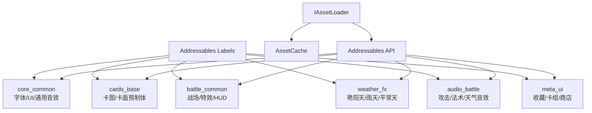
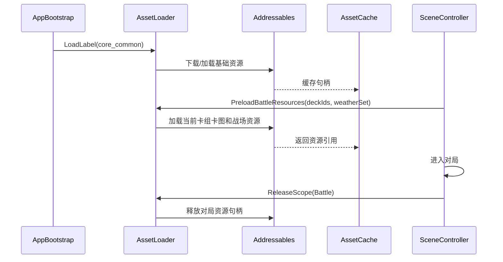
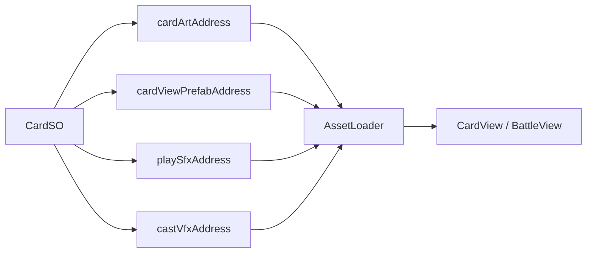
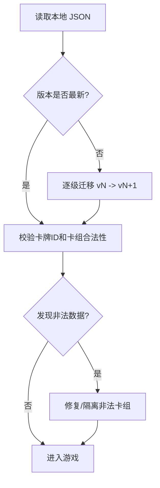

# 资源管理

资源管理负责卡图、卡牌预制体、特效、音频、字体、配置表和存档的加载、缓存、释放与版本迁移。项目移动端优先，资源策略必须避免“全部常驻”，对局内只保留当前模式真正需要的内容。

## 资源分类

| 类型 | 示例 | 加载策略 | 释放策略 |
| --- | --- | --- | --- |
| 常驻基础资源 | 通用 UI 图集、字体、通用音效、卡牌框。 | 启动后预加载。 | 应用退出释放。 |
| 对局资源 | 当前卡组卡图、战场预制体、天气特效、伤害数字。 | 进入对局前按卡组和场景预热。 | 离开对局后释放。 |
| 局外资源 | 卡牌收藏大图、商店图、卡包动画。 | 进入页面按需加载。 | 离开页面释放。 |
| 稀有资源 | 高品质立绘、特殊终结动画。 | 首次使用异步加载，可降级。 | LRU 缓存或场景切换释放。 |
| 配置资源 | CardSO、EffectSO、BalanceConfig。 | 启动或进入模式前加载。 | 版本切换时刷新。 |
| 存档数据 | 玩家收藏、卡组、设置。 | 启动读取，关键操作后保存。 | 不适用。 |

## Addressables 结构



### 标签建议

| Label | 内容 |
| --- | --- |
| `core_common` | 字体、通用 UI 图集、通用按钮音效、加载界面。 |
| `battle_common` | 战场格位、卡牌 View、目标选择器、伤害数字、通用 Buff 图标。 |
| `cards_set_001` | 首发卡池卡图和卡牌配置。 |
| `weather_sunny` | 艳阳天背景、粒子、音效。 |
| `weather_rain` | 雨天背景、粒子、音效。 |
| `meta_deckbuilder` | 卡组编辑器 UI、筛选图标、卡牌收藏页资源。 |
| `audio_battle` | 对局音效和短音乐片段。 |

## 加载流程



### 加载作用域

| Scope | 创建时机 | 内容 | 释放时机 |
| --- | --- | --- | --- |
| `GlobalScope` | 应用启动 | 基础 UI、字体、通用音频。 | 应用退出。 |
| `BattleScope` | 进入对局前 | 战场、当前卡组卡图、天气、战斗音效。 | 对局结束回到主界面。 |
| `DeckBuilderScope` | 进入卡组编辑器 | 收藏页卡图缩略图、筛选 UI。 | 离开卡组编辑器。 |
| `ShopScope` | 进入商店 | 卡包、商品图、购买动画。 | 离开商店。 |

## AssetLoader 接口

```text
IAssetLoader
  LoadAsync<T>(address)
  LoadLabelAsync(label, scope)
  InstantiateAsync(address, parent, scope)
  Release(handle)
  ReleaseScope(scope)
  IsLoaded(address)
```

业务层只依赖 `IAssetLoader`，不直接调用 Addressables。这样可以在测试中替换为 Fake Loader，也能集中处理加载失败、默认占位图和资源统计。

## 卡牌资源映射



### CardSO 资源字段建议

| 字段 | 说明 |
| --- | --- |
| `cardArtAddress` | 卡牌半身/全身图。 |
| `cardPortraitAddress` | 小头像或缩略图，可与大图分离。 |
| `cardFrameStyle` | 稀有度、阵营、元素对应的框体样式。 |
| `playSfxAddress` | 打出音效。 |
| `castVfxAddress` | 法术或入场特效。 |
| `weatherVfxAddress` | 天气牌或天气效果触发时使用。 |

## 存档系统

当前已有 `JsonDeckStorage V2 + PlayerProfileSave v8` 方向，建议明确版本迁移规则。



### 存档内容

| 文件 | 内容 |
| --- | --- |
| `player_profile.json` | 玩家 ID、昵称、进度、货币、设置版本。 |
| `collection.json` | 已拥有卡牌、数量、皮肤、收藏标记。 |
| `decks_v2.json` | 卡组列表、主地区、副地区、赞助商、卡牌 ID 列表。 |
| `settings.json` | 音量、画质、语言、震动、辅助显示。 |

### 迁移原则

- 每次存档结构变化必须提升版本号。
- 迁移只做结构转换，不偷偷改玩家资源数量。
- 找不到的卡牌 ID 标记为非法并从卡组中移除，同时保留原始备份。
- 卡组修复后需要给 UI 明确提示，例如“部分卡牌已下架，卡组需重新调整”。

## 加载失败降级

| 失败类型 | 降级方案 |
| --- | --- |
| 卡图缺失 | 显示默认占位卡图，并记录卡牌 ID。 |
| 音效缺失 | 静默跳过，不阻塞规则。 |
| 特效缺失 | 播放通用闪光或只显示数值。 |
| CardSO 缺失 | 禁止进入对局，提示数据版本错误。 |
| 存档损坏 | 尝试读取备份；失败则创建新存档并保留坏档。 |

## 内存预算

| 场景 | 目标 |
| --- | --- |
| 主界面 | 只保留基础 UI 和少量展示资源。 |
| 卡组编辑器 | 卡图缩略图分页加载，避免一次加载全卡池大图。 |
| 对局 | 预热双方卡组相关卡图，非当前卡组资源不常驻。 |
| 天气切换 | 当前天气资源常驻，预测天气可提前轻量预热。 |

## 资源审计

建议增加编辑器检查工具：

| 检查项 | 说明 |
| --- | --- |
| 卡牌资源引用完整 | 每张 CardSO 必须有有效卡图或明确允许占位。 |
| Addressables 标签正确 | 对局资源不能误放到局外标签。 |
| 重复资源 | 同图不同地址、同音效多份导入需要警告。 |
| 大图尺寸 | 移动端卡图超过预算时提示压缩。 |
| 未使用资源 | 不被任何 CardSO、场景或配置引用的资源列出。 |

## 测试清单

| 用例 | 验证点 |
| --- | --- |
| 冷启动 | `core_common` 能加载完成并进入主界面。 |
| 对局预热 | 当前双方卡组卡图加载完成后才进入战场。 |
| 离开对局 | `BattleScope` 资源句柄全部释放。 |
| 卡图缺失 | 显示占位图，不影响对局规则。 |
| 存档迁移 | 旧版本卡组能迁移到最新结构。 |
| 损坏存档 | 不崩溃，能保留坏档并创建新档。 |

